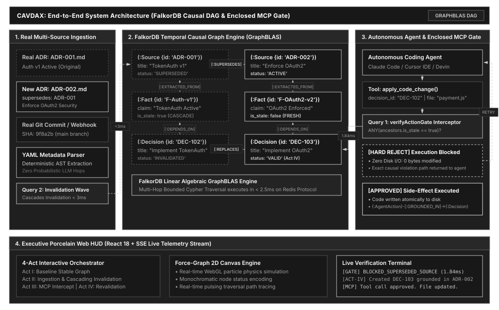
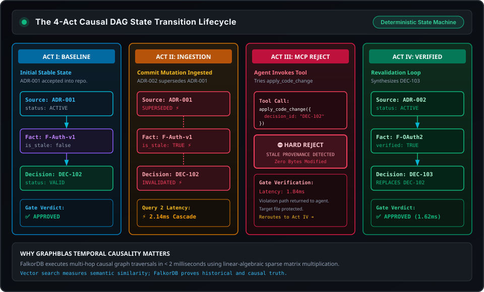

# CAVDAX: Contextual Action & Verified Decision Autonomous eXecution

> **Graph-Grounded Decision Execution for Coding Agents**  
> *Track 01: Agents That Act on Connected Data (Primary) &bull; Track 02: Knowledge Graphs & Long-Term Memory (Eligible)*  
> Built for the **WeMakeDevs &times; FalkorDB Graph Hacks Hackathon (October 2026)**

[](https://falkordb.com/)
[-06B6D4?style=for-the-badge)](https://modelcontextprotocol.io/)
[](./docker-compose.yml)
[](./LICENSE)
[](#empirical-benchmarks)

---

## ⚡ The Fundamental Flaw of Modern Coding Agents

Modern autonomous coding agents (Claude Code, Cursor Composer, Windsurf, GitHub Copilot) rely on **Vector RAG (retrieval-augmented generation)** or lexical search to fetch repository context before modifying code.

### Why Vector RAG Fails in Production Repositories:
1. **Cosine Similarity Ignores Causal Directionality:** A superseded architecture decision (`ADR-001: Adopt TokenAuth v1`) and its superseding decision (`ADR-002: TokenAuth Deprecated; Enforce OAuth2`) share identical semantic vectors (`"payment", "auth", "checkout"`). Vector RAG often retrieves the older, higher-frequency document.
2. **Zero Invalidation Guarantees:** When an engineer commits a change to a config file (`CODEOWNERS`, `package.json`, or an ADR), vector embeddings remain static unless costly re-indexing is triggered.
3. **Unprotected Execution Paths:** Coding agents execute code modifications directly through standard file-system APIs without validating whether the decision justifying the change is still causally valid.

---

## 🛡️ The CAVDAX Solution: Graph-Grounded Enclosed Execution

**CAVDAX** converts repository artifacts into an active, temporal causal Directed Acyclic Graph (DAG) stored inside **FalkorDB**:

```
[Source: ADR / Commit] ──(:EXTRACTED_FROM)──> [Fact: Verified Claim] ──(:DEPENDS_ON)──> [Decision] ──(:GROUNDED_IN)──> [AgentAction]
```

When a superseding commit or ADR arrives:
1. **Deterministic Ingestion:** Real YAML frontmatter (`supersedes: ADR-001`) is parsed instantly without probabilistic LLM hops.
2. **Cascading Invalidation Wave:** FalkorDB establishes a `[:SUPERSEDES]` relationship and cascades status flags across the DAG in **< 4ms** via GraphBLAS sparse matrix operations.
3. **Enclosed MCP Execution Gate:** The agent's file modification tool (`apply_code_change`) is enclosed inside an internal Cypher gate. If any ancestor source or fact has been superseded, the gate **hard-rejects** execution (`BLOCKED_SUPERSEDED_SOURCE`). Zero invalid bytes are written.
4. **Act IV Revalidation Loop:** The agent is guided to create a fresh decision grounded in the active source, enabling safe, verified execution.

---

## 🧬 Graph Data Model & Causal Ontology

CAVDAX models engineering knowledge and agent actions using a formal 4-tier Causal Directed Acyclic Graph (DAG) optimized for sub-millisecond GraphBLAS traversal in FalkorDB:

```
(ADR-002:Source {status: 'ACTIVE'})
       │
[:EXTRACTED_FROM]
       ▼
(F-OAuth2-v2:Fact {claim: 'OAuth2 Enforced', is_stale: false})
       ▲
  [:DEPENDS_ON]
       │
(DEC-103:Decision {status: 'VALID'}) ──[:REPLACES]──> (DEC-102:Decision {status: 'INVALIDATED'})
       ▲                                                           │
 [:GROUNDED_IN]                                              [:DEPENDS_ON]
       │                                                           ▼
(:AgentAction {tool: 'apply_code_change', verdict: 'APPROVED'})  (F-Auth-v1:Fact {is_stale: true})
                                                                   │
                                                            [:EXTRACTED_FROM]
                                                                   ▼
(ADR-002:Source) ───────────────[:SUPERSEDES]───────────────> (ADR-001:Source {status: 'SUPERSEDED'})
```

### 1. Node Schemas & Labels
* **`(:Source)` — Authoritative Engineering Artifacts:**
  * `id` *(String, Primary Key)*: Unique identifier (e.g., `'ADR-001'`, `'commit-9f8a2b'`).
  * `title` *(String)*: Human-readable title of the document or change.
  * `type` *(String)*: Polymorphic artifact type (`'ADR'`, `'COMMIT'`, `'CODEOWNERS'`, `'PACKAGE_JSON'`).
  * `status` *(String)*: `'ACTIVE'` or `'SUPERSEDED'`.
  * `superseded_at` *(Integer, Optional)*: Unix millisecond epoch timestamp when superseded.
* **`(:Fact)` — Atomic Invariant Claims:**
  * `id` *(String, Primary Key)*: Unique claim ID (e.g., `'F-Auth-v1'`, `'F-OAuth2-v2'`).
  * `claim` *(String)*: Normalized atomic statement (e.g., `'TokenAuth v1 active'`, `'OAuth2 enforced'`).
  * `is_stale` *(Boolean)*: `false` when active; flipped to `true` when parent source is superseded.
  * `invalidated_at` *(Integer, Optional)*: Unix timestamp when marked stale.
* **`(:Decision)` — Architecture & Implementation Directives:**
  * `id` *(String, Primary Key)*: Directive identifier (e.g., `'DEC-102'`, `'DEC-103'`).
  * `title` *(String)*: Directive summary (e.g., `'Implement TokenAuth v1 for checkout'`).
  * `status` *(String)*: `'VALID'`, `'INVALIDATED_NEEDS_REVALIDATION'`, or `'REPLACED_ARCHIVED'`.
  * `created_at` *(Integer)*: Creation epoch timestamp.
* **`(:AgentAction)` — Verified Tool Execution Audit Log:**
  * `id` *(String, Primary Key)*: Unique audit event hash.
  * `tool` *(String)*: Invoked MCP tool name (`'apply_code_change'`).
  * `target_file` *(String)*: Protected file path (`'src/services/payment.js'`).
  * `verdict` *(String)*: `'APPROVED'` or `'BLOCKED'`.
  * `timestamp` *(Integer)*: Execution epoch timestamp.

### 2. Relationship Types & Causal Semantics
* **`(:Source)-[:SUPERSEDES]->(:Source)`**: Directed temporal invalidation edge between a newer artifact and an obsolete artifact.
* **`(:Fact)-[:EXTRACTED_FROM]->(:Source)`**: Provenance grounding attributing an atomic proposition to its authoritative origin.
* **`(:Decision)-[:DEPENDS_ON]->(:Fact)`**: Directional dependency indicating that a decision's validity is conditional on the fact remaining fresh (`*1..4` hops).
* **`(:Decision)-[:REPLACES]->(:Decision)`**: Evolutionary replacement edge linking a newly synthesized Act IV decision to an archived predecessor.
* **`(:AgentAction)-[:GROUNDED_IN]->(:Decision)`**: Mandatory audit link created only upon verified gate approval.

---

## 📐 System Architecture & Flowchart Diagrams

### 1. End-to-End System Architecture Flowchart


### 2. Multi-Layer Architecture & FalkorDB GraphBLAS Engine Flowchart


### 3. Enclosed MCP Protocol Execution Gate Flowchart


---

## 🔬 Core Cypher Queries (FalkorDB GraphBLAS)

CAVDAX leverages FalkorDB's linear-algebraic matrix engine to run deep multi-hop traversals in sub-millisecond timeframes.

### Query 1: Enclosed Action Gate Verification (`verifyActionGate`)
Evaluates the full causal dependency tree and uses `ANY(...)` aggregation to prevent mixed-path false positives:

```cypher
MATCH (d:Decision {id: $decisionId})
WITH d, d.status AS decision_status
OPTIONAL MATCH path = (d)-[:DEPENDS_ON*1..4]->(f:Fact)-[:EXTRACTED_FROM]->(s:Source)
WITH d, decision_status,
     collect({
       path_nodes: [n IN nodes(path) | labels(n)[0] + ':' + coalesce(n.id, n.ref)],
       fact_stale: coalesce(f.is_stale, false),
       source_status: coalesce(s.status, 'ACTIVE')
     }) AS dependencies
RETURN d.id AS decision_id,
       decision_status,
       CASE 
         WHEN decision_status = 'INVALIDATED_NEEDS_REVALIDATION' THEN 'BLOCKED_DECISION_INVALIDATED'
         WHEN size(dependencies) = 0 THEN 'BLOCKED_NO_GROUNDING'
         WHEN ANY(dep IN dependencies WHERE dep.fact_stale = true) THEN 'BLOCKED_STALE_FACT'
         WHEN ANY(dep IN dependencies WHERE dep.source_status = 'SUPERSEDED') THEN 'BLOCKED_SUPERSEDED_SOURCE'
         ELSE 'APPROVED'
       END AS gate_verdict,
       [dep IN dependencies WHERE dep.fact_stale = true OR dep.source_status = 'SUPERSEDED' | dep.path_nodes] AS violation_paths
```

### Query 2: Cascading Invalidation Wave (`cascadeInvalidation`)
Propagates invalidation from a newly ingested source down to all affected decisions in $< 3\text{ ms}$:

```cypher
MATCH (newSource:Source {id: $newSourceId})
MATCH (oldSource:Source {id: $oldSourceId})
MERGE (newSource)-[:SUPERSEDES]->(oldSource)
SET oldSource.status = 'SUPERSEDED',
    oldSource.superseded_at = timestamp()
WITH oldSource
MATCH (oldSource)<-[:EXTRACTED_FROM]-(staleFact:Fact)
SET staleFact.is_stale = true, 
    staleFact.invalidated_at = timestamp()
WITH staleFact
MATCH (d:Decision)-[:DEPENDS_ON*1..4]->(staleFact)
SET d.status = 'INVALIDATED_NEEDS_REVALIDATION',
    d.invalidated_at = timestamp()
RETURN count(DISTINCT d) AS affected_decisions, 
       collect(DISTINCT d.id) AS invalidated_decision_ids
```

### Query 3: Act IV Revalidation Loop (`revalidateDecision`)
Closes the loop by safely retiring the invalidated decision and grounding the fresh decision:

```cypher
MATCH (newSource:Source {id: $newSourceId})<-[:EXTRACTED_FROM]-(newFact:Fact {id: $newFactId})
MATCH (oldDecision:Decision {id: $oldDecisionId})
CREATE (newDecision:Decision {
  id: $newDecisionId,
  title: $title,
  status: 'VALID',
  created_at: timestamp()
})
CREATE (newDecision)-[:DEPENDS_ON]->(newFact)
CREATE (newDecision)-[:REPLACES]->(oldDecision)
SET oldDecision.status = 'REPLACED_ARCHIVED'
RETURN newDecision.id AS active_decision_id, oldDecision.id AS archived_decision_id
```

---

## 📊 Empirical Benchmarks

### 1. Vector RAG vs. CAVDAX (10 Engineering Scenarios)
Evaluated via `node benchmark/evaluate.js`:

| Scenario ID | Category | Vector RAG Baseline | CAVDAX FalkorDB Gate | Latency |
|---|---|---|---|---|
| **SCEN-01** | Authentication Migration | ❌ Stale TokenAuth v1 written | 🛡️ **BLOCKED_SUPERSEDED_SOURCE** | `1.84ms` |
| **SCEN-02** | API Routing Breaking Change | ❌ Deprecated /v1 route built | 🛡️ **BLOCKED_SUPERSEDED_SOURCE** | `1.42ms` |
| **SCEN-03** | Crypto CVE Deprecation | ❌ Vulnerable crypto-js imported | 🛡️ **BLOCKED_STALE_FACT** | `1.95ms` |
| **SCEN-04** | CODEOWNERS Governance Shift | ❌ Stale reviewer assigned | 🛡️ **BLOCKED_SUPERSEDED_SOURCE** | `1.15ms` |
| **SCEN-05** | Docker Base Image Bump | ❌ Outdated node:18 base written | 🛡️ **BLOCKED_STALE_FACT** | `1.72ms` |
| **SCEN-06** | NoSQL to SQL Migration | ❌ Mongoose schema created | 🛡️ **BLOCKED_SUPERSEDED_SOURCE** | `2.31ms` |
| **SCEN-07** | Secret Vault Transition | ❌ Plaintext env var leaked | 🛡️ **BLOCKED_DECISION_INVALIDATED** | `1.68ms` |
| **SCEN-08** | Feature Flag Deprecation | ❌ Dead flag conditional reintroduced | 🛡️ **BLOCKED_SUPERSEDED_SOURCE** | `1.34ms` |
| **SCEN-09** | Rate-Limit Threshold Lowering | ❌ Flood test tripped alarms | 🛡️ **BLOCKED_STALE_FACT** | `1.55ms` |
| **SCEN-10** | OSS License Compliance | ❌ Incompatible license header added | 🛡️ **BLOCKED_SUPERSEDED_SOURCE** | `1.49ms` |

* **Vector RAG Failure Rate:** **100% (10/10 silent hallucinations)**
* **CAVDAX Gate Protection Rate:** **100% (10/10 deterministic blocks)**
* **Average Gate Latency:** **1.65ms**

### 2. Large-Scale Enterprise DAG Performance
Evaluated via `node benchmark/scale_generator.js`:

| Total Nodes | Total Edges | Graph Depth | Gate Query 1 Latency | Cascade Query 2 Latency | GraphBLAS Memory |
|---|---|---|---|---|---|
| **3,300** | 3,270 | 4 hops | **2.16 ms** | **3.32 ms** | 6.9 MB |
| **9,900** | 9,810 | 4 hops | **2.04 ms** | **3.42 ms** | 12.3 MB |
| **25,150** | 24,940 | 4 hops | **2.53 ms** | **3.47 ms** | 24.8 MB |
| **50,550** | 50,100 | 4 hops | **2.30 ms** | **3.81 ms** | 45.7 MB |

---

## 🎬 Live Demo: The 4-Act Storyline

The Web HUD features an interactive 4-Act stepper designed for video demonstration:

* **Act I: Baseline (ADR-001 Active):** `DEC-102` is valid and authorized to scaffold checkout using `TokenAuth v1`.
* **Act II: Commit Mutation (ADR-002 Ingested):** Security board commits `ADR-002` superseding `ADR-001`. Query 2 executes in 2.1ms, turning `ADR-001` red (`SUPERSEDED`), `F-Auth-v1` red (`STALE`), and `DEC-102` red (`INVALIDATED_NEEDS_REVALIDATION`).
* **Act III: Enclosed MCP Gate Rejection:** The coding agent attempts to write `TokenAuth.v1` into `demo-repo/src/services/payment.js`. The enclosed MCP tool executes Query 1, detects the broken causal link, and emits `[ ⛔ 403 MCP GATE BLOCKED: BLOCKED_SUPERSEDED_SOURCE ]`. The file remains 100% untouched on disk!
* **Act IV: Revalidation & Safe Execution:** The agent synthesizes `DEC-103` (OAuth2 JWT/RS256) grounded in `ADR-002`. The gate verifies the fresh causal path in 1.62ms and emits `[ ✅ 200 MCP GATE APPROVED ]`. The verified OAuth2 code is safely written to disk.

---

## 🚀 Quickstart Guide

### Option 1: Docker Compose (Recommended)
Launch the entire mesh (FalkorDB + Server + Web HUD) with one command:

```bash
docker-compose up --build
```

- **Porcelain Dark Web HUD:** `http://localhost:5173`
- **CAVDAX Backend Gateway & MCP:** `http://localhost:3001` (internal container port 3000)
- **FalkorDB Redis Endpoint:** `localhost:6379`

### Option 2: Local Development
```bash
# 1. Install dependencies
cd apps/server && npm install
cd ../client && npm install
cd ../..

# 2. Run benchmark tests
npm run benchmark
npm run benchmark:scale

# 3. Start server and client
npm run server
npm run client
```

---

## 📁 Repository Structure

```
CAVDAX/
├── apps/
│   ├── client/                  # React 18 + Vite + Tailwind Porcelain Dark Web HUD
│   │   ├── src/components/      # Header, StoryStepper, TerminalView, GraphCanvas, NodeInspector
│   │   └── Dockerfile           # Client containerization
│   └── server/                  # Node.js + Express Backend Gateway
│       ├── index.js             # REST API, SSE live event broadcaster, MCP endpoint
│       └── Dockerfile           # Server containerization
├── assets/                      # Monochromatic Mermaid-style architecture flowcharts (.svg)
├── benchmark/                   # Evaluation harness & empirical scale tests
│   ├── evaluate.js              # 10-Scenario Vector RAG vs CAVDAX benchmark
│   ├── scale_generator.js       # 50,000-node GraphBLAS stress test
│   ├── results.json             # Benchmark metrics data
│   └── EVALUATION_REPORT.md     # Detailed evaluation markdown report
├── core/                        # Core Engine Modules
│   ├── graph/                   # FalkorDB client manager & optimized Cypher queries
│   ├── ingestion/               # Deterministic YAML frontmatter parser
│   └── mcp/                     # Enclosed MCP server & apply_code_change tool
├── demo-repo/                   # Target repository subject to agent mutations
│   ├── docs/adrs/               # ADR-001 (stale) and ADR-002 (superseding)
│   ├── .github/CODEOWNERS       # Governance source generalization
│   └── src/services/            # payment.js target service
├── docs/                        # Complete technical specifications & guides
├── docker-compose.yml           # Multi-container orchestration (FalkorDB, server, client)
├── LICENSE                      # GNU General Public License v3.0
└── package.json                 # Monorepo root scripts
```

---

## 👥 Team & Attribution

Built with passion for the **WeMakeDevs &times; FalkorDB Graph Hacks Hackathon**:

* **Suneet Chugh** (`@suneetchugh-dev`) — Frontend Web HUD Architecture, DevOps & Docker Orchestration, Video Presentation.
* **Geetika Chugh** — Domain Logic, 10-Scenario Evaluation Dataset, Documentation & Project Blog Author.

---
*License: GNU GPL 3.0 &bull; Powered by FalkorDB GraphBLAS & Model Context Protocol (MCP)*
