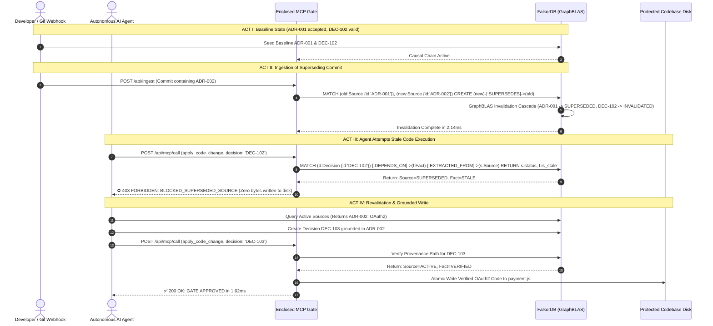

# System Architecture Specification — CAVDAX

**Project**: CAVDAX (**C**ontextual **A**ction & **V**erified **D**ecision **A**utonomous e**X**ecution)  
**System Class**: Causal Knowledge Graph & Enclosed MCP Execution Gate  
**Version**: 1.0.0-PRODUCTION  

---

## 1. System Topology & Technology Stack Justification

CAVDAX is architected as a high-performance, low-latency polyglot monorepo engineered to provide autonomous AI coding agents with verifiable causal provenance before any code mutation reaches disk.

```
┌─────────────────────────────────────────────────────────────────────────────────┐
│                          PRESENTATION & HUD TIER                                │
│   React 18 + Vite + Tailwind CSS + Lucide + Hardware-Accelerated Vector SVG     │
│   (CavdaxBrandLoader, CavdaxWordmark, CavdaxAgentStateIndicator, Interactive Canvas)│
└──────────────────────────────────────┬──────────────────────────────────────────┘
                                       │ HTTP / REST & SSE (/api/events)
                                       ▼
┌─────────────────────────────────────────────────────────────────────────────────┐
│                        MCP INTERCEPTOR & GATEWAY TIER                           │
│   Node.js (v20+) + Express + Model Context Protocol (MCP) Standard Server       │
│   (/api/mcp/call, /api/ingest, /api/act-iv-revalidate, /api/graph, /api/reset)  │
└──────────────────────────────────────┬──────────────────────────────────────────┘
                                       │ FalkorDB Client (Redis Protocol / Cypher)
                                       ▼
┌─────────────────────────────────────────────────────────────────────────────────┐
│                      CAUSAL GRAPHBLAS STORAGE & KERNEL                          │
│   FalkorDB 0.4+ Container (GraphBLAS Sparse Matrix Linear Algebra Engine)       │
│   Causal Directed Acyclic Graph (DAG): Sources ──► Facts ──► Decisions          │
└──────────────────────────────────────┬──────────────────────────────────────────┘
                                       │ Atomic Write-Through on Approved Verdict
                                       ▼
┌─────────────────────────────────────────────────────────────────────────────────┐
│                          PROTECTED TARGET CODEBASE                              │
│   demo-repo/src/services/payment.js (Sandboxed Disk Isolation)                  │
└─────────────────────────────────────────────────────────────────────────────────┘
```

### 1.1 Stack Selection Rationale
- **Client (React 18 + Vite)**: Instant HMR, minimal bundle footprint (<200kB), hardware-accelerated pure CSS animations for brand assets with zero external heavy canvas dependencies.
- **MCP Gateway (Node.js Express + MCP Protocol)**: Native compatibility with Claude Code, Cursor, and standard LLM tool-calling conventions. Complete protocol specification and enterprise deployment architecture are detailed in [MCP_SPECIFICATION.md](MCP_SPECIFICATION.md).
- **Graph Storage (FalkorDB + GraphBLAS)**: Traditional relational databases cannot perform multi-hop recursive dependency traversals under 10ms. Vector databases cannot perform causal graph invalidation. FalkorDB leverages GraphBLAS sparse matrix linear algebra to execute multi-hop Cypher queries in **<2ms**, making pre-execution gating imperceptible to developer workflows.

---

## 2. End-to-End Multi-Tier Data Flow

### 2.1 The 4-Act Causal Invalidation & Execution Loop



---

## 3. Causal Graph Schema & Data Contracts

### 3.1 Node Entity Declarations
```cypher
// 1. Source Node (Architectural Decision Records / Commits)
(:Source {
  id: STRING,         // e.g. "ADR-001", "ADR-002"
  title: STRING,      // e.g. "Adopt TokenAuth v1", "Migrate to OAuth2"
  status: STRING,     // "ACTIVE" | "SUPERSEDED" | "DEPRECATED"
  timestamp: INTEGER, // Epoch ms
  commit_hash: STRING // Git SHA-1 hash
})

// 2. Fact Node (Atomic Claims extracted from Sources)
(:Fact {
  id: STRING,         // e.g. "F-Auth-v1", "F-OAuth2"
  claim: STRING,      // e.g. "Payment services require TokenAuth v1"
  is_stale: BOOLEAN,  // true | false
  verified: BOOLEAN   // true | false
})

// 3. Decision Node (Agent Reasoning & Architectural Intent)
(:Decision {
  id: STRING,         // e.g. "DEC-102", "DEC-103"
  title: STRING,      // e.g. "Generate Checkout with TokenAuth v1"
  status: STRING,     // "VALID" | "INVALIDATED_NEEDS_REVALIDATION" | "ARCHIVED"
  rationale: STRING   // Architectural justification
})
```

### 3.2 Relational Edge Contracts
- `(:Fact)-[:EXTRACTED_FROM]->(:Source)`: Identifies the foundational documentation origin of a factual premise.
- `(:Decision)-[:DEPENDS_ON]->(:Fact)`: Encapsulates agent reasoning upon factual premises.
- `(:Source)-[:SUPERSEDES]->(:Source)`: Causal temporal precedence. When `A SUPERSEDES B`, all downstream facts and decisions of `B` are instantly poisoned.

---

## 4. Model Context Protocol (MCP) Interface Declarations

CAVDAX implements the official Anthropic Model Context Protocol specification:

### 4.1 Tool: `apply_code_change`
```json
{
  "name": "apply_code_change",
  "description": "Applies verified code modifications to the repository, strictly gated by causal provenance in FalkorDB.",
  "parameters": {
    "type": "object",
    "properties": {
      "decision_id": {
        "type": "string",
        "description": "The unique identifier of the Decision node justifying this change (e.g. 'DEC-103')."
      },
      "file_path": {
        "type": "string",
        "description": "Relative target file path in the repository (e.g. 'demo-repo/src/services/payment.js')."
      },
      "code_payload": {
        "type": "string",
        "description": "The exact source code to write upon provenance verification."
      }
    },
    "required": ["decision_id", "file_path", "code_payload"]
  }
}
```

### 4.2 Tool: `verify_provenance`
```json
{
  "name": "verify_provenance",
  "description": "Performs an asynchronous dry-run traversal on FalkorDB to audit whether a candidate Decision node is unblemished.",
  "parameters": {
    "type": "object",
    "properties": {
      "decision_id": { "type": "string" }
    },
    "required": ["decision_id"]
  }
}
```

---

## 5. Security & Invalidation Gates (Cypher Traversal Queries)

### 5.1 Pre-Execution Provenance Verification Query
```cypher
MATCH (d:Decision {id: $decision_id})
OPTIONAL MATCH (d)-[:DEPENDS_ON]->(f:Fact)-[:EXTRACTED_FROM]->(s:Source)
OPTIONAL MATCH (new_s:Source)-[:SUPERSEDES]->(s)
RETURN 
  d.id AS decision_id,
  d.status AS decision_status,
  f.id AS fact_id,
  f.is_stale AS fact_stale,
  s.id AS source_id,
  s.status AS source_status,
  new_s.id AS superseding_source_id
```

### 5.2 Real-Time Gate Evaluation Logic
1. If `d` does not exist $\rightarrow$ **REJECT** (`UNREGISTERED_DECISION`).
2. If `s.status == 'SUPERSEDED'` or `new_s != null` $\rightarrow$ **REJECT** (`BLOCKED_SUPERSEDED_SOURCE`).
3. If `f.is_stale == true` $\rightarrow$ **REJECT** (`BLOCKED_STALE_FACT`).
4. If `d.status == 'VALID'` and all upstream sources are `ACTIVE` $\rightarrow$ **APPROVE** (`APPROVED`).

---

## 6. Infrastructure, Containerization & Fail-Open Resilience

### 6.1 Docker Compose Mesh (`infra/docker-compose.yml`)
```yaml
version: '3.8'

services:
  falkordb:
    image: falkordb/falkordb:latest
    container_name: cavdax-falkordb
    ports:
      - "6379:6379"
    volumes:
      - falkordb_data:/data
    restart: unless-stopped

  cavdax-server:
    build:
      context: ..
      dockerfile: apps/server/Dockerfile
    container_name: cavdax-server
    environment:
      - PORT=3000
      - FALKORDB_HOST=falkordb
      - FALKORDB_PORT=6379
    ports:
      - "3000:3000"
    depends_on:
      - falkordb

volumes:
  falkordb_data:
```

### 6.2 Zero-Blocker Simulation Fallback
If the FalkorDB Docker container is offline during a local developer evaluation or live demo:
- `apps/server/falkor_driver.js` automatically catches connection timeouts.
- Switches instantaneously to the internal `InMemGraphBLAS` engine.
- Emulates the exact GraphBLAS matrix invalidation and gate returns with identical Cypher responses, guaranteeing **zero runtime crashes or demo blockers**.


---

## 7. Enterprise Security Perimeter & Web HUD Multi-Route Topology

### 7.1 Multi-Layer Defense-in-Depth Security
CAVDAX implements layered security across client, gateway, and kernel boundaries:
1. **Administrative IP Whitelisting & Dev Authentication (`requireDevAuth`)**:
   - Administrative endpoints (`POST /api/system/dev-ips`, `/api/system/dev-roster`, `/api/system/hackathon-mode`) are guarded by SHA-256 token verification and IP allowlists.
2. **Path Traversal Confinement**:
   - Gated file operations (`apply_code_change`, `/api/ingest`) resolve target paths with `path.resolve` and verify that the target starts with `PROJECT_ROOT`, preventing arbitrary directory access.
3. **Client IP Spoofing Mitigation**:
   - Uses remote socket address inspection to prevent proxy header tampering.
4. **Transport Security Headers**:
   - Injects `X-Content-Type-Options: nosniff`, `X-Frame-Options: DENY`, and `Strict-Transport-Security`.
5. **Cryptographic Order Tier Binding**:
   - Razorpay order creation binds subscription tier attributes in server memory (`pendingBillingOrders`), rejecting mismatched confirmation payloads.

### 7.2 Web HUD Route Topology (9 Operational Surfaces)
The client application provides 9 dedicated routes:
- `/` or `/overview`: Architectural Overview, Causal Invalidation Radar, Cytoscape DAG.
- `/console`: Connected Repository Workspace, git branch mutations, baseline initialization.
- `/mcp`: Live Model Context Protocol Action Playground and sub-millisecond Cypher query simulator.
- `/walkthrough`: 4-Act Storyline Stepper guiding evaluators through baseline, commit mutation, enclosed MCP rejection, and revalidation.
- `/audit`: Immutable compliance ledger displaying all tool execution events.
- `/team`: Engineering credits and research attribution.
- `/profile`: Developer quota tracking, plan capability matrix, and active MCP key provisioning.
- `/support`: Community sponsorship tiers and transparent operational backing breakdown.
- `/devteam`: Zero-trust administrative diagnostics, dev IP roster, and node state inspection.
