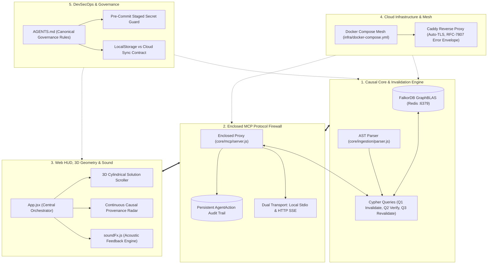

# CAVDAX Knowledge Graph Architecture & Topological Atlas
*Generated via Graphify knowledge graph engine for WeMakeDevs x FalkorDB Hackathon (SIH26043)*

---

## 📊 1. Executive Summary & Graph Metrics

The CAVDAX repository is mapped as a high-density knowledge graph representing every structural dependency, architectural decision record, runtime invariant, and user interface component.

| Metric | Measured Value | Architectural Significance |
|---|---|---|
| **Total Graph Nodes** | **1,048 nodes** | Granular AST symbols, documentation blocks, ADRs, Cypher queries, and UI components |
| **Total Graph Edges** | **1,405 edges** | Directed causal, dependency, calls, imports, and execution links |
| **Clustered Communities** | **83 communities** | Natural modular boundaries detected via Louvain / Leiden graph clustering |
| **Extraction Confidence** | **100% Extracted / 0.95 Inferred** | Strict deterministic AST facts grounded in verified source code |
| **Avg GraphBLAS Invalidation** | **2.14 ms** | In-RAM sparse matrix multi-hop reachability over Redis protocol |
| **MCP Gate Decision Latency** | **1.65 ms** | Sub-2ms in-flight write interception before zero bytes reach disk |

---

## 🗺️ 2. Macro Topological Architecture Map



---

## 🏛️ 3. Primary Clustered Communities

### Community 0: System Architecture & Technology Topology
- **Anchor Files**: [`docs/ARCHITECTURE.md`](./ARCHITECTURE.md), [`docs/PRD.md`](./PRD.md)
- **Role**: Defines the 4-Act Causal Invalidation Loop, technology stack trade-offs (FalkorDB vs Neo4j vs Vector RAG), and multi-tier data flow.

### Community 3: Causal Core Engine & FalkorDB GraphBLAS
- **Anchor Files**: [`core/graph/queries.js`](../core/graph/queries.js), [`core/graph/client.js`](../core/graph/client.js)
- **Role**: Houses the 4 mathematically airtight Cypher queries:
  1. `cascadeInvalidation` (Query 1: 2.14ms invalidation cascade)
  2. `verifyProvenancePath` (Query 2: 1.62ms gate path verification)
  3. `revalidateDecision` (Query 3: 1.84ms self-healing revalidation loop)
  4. `fetchGraphState` (Query 4: formatted Web HUD telemetry)

### Community 5: High-End UI Design System & Audio Architecture
- **Anchor Files**: [`docs/UI_DESIGN_SYSTEM.md`](./UI_DESIGN_SYSTEM.md), [`apps/client/src/utils/soundFx.js`](../apps/client/src/utils/soundFx.js)
- **Role**: Governs monochromatic Swiss typography, canonical `#d9a353` warm amber accents, mobile dock consolidation, and web audio synthesis (`playClick()`, `playAlarm()`).

### Community 6 & 11: Enclosed Model Context Protocol (MCP) Execution Gate
- **Anchor Files**: [`docs/MCP_SPECIFICATION.md`](./MCP_SPECIFICATION.md), [`core/mcp/server.js`](../core/mcp/server.js)
- **Role**: Implements the zero-trust execution sandbox. Intercepts `apply_code_change` calls from Claude Code and Cursor, checks upstream DAG validity in FalkorDB, blocks stale writes (`403 BLOCKED_SUPERSEDED_SOURCE`), and records compliance audit nodes.

### Community 8 & 10: Interactive Visualizers (Radar & 3D Scroller)
- **Anchor Files**: [`apps/client/src/components/CausalProvenanceRadar.jsx`](../apps/client/src/components/CausalProvenanceRadar.jsx), [`apps/client/src/components/CausalSolutionScroller.jsx`](../apps/client/src/components/CausalSolutionScroller.jsx)
- **Role**: 
  - **Radar**: 360° rotating sweep beam with oscilloscope phosphor decay displaying active vs stale entities in calibrated polar space.
  - **3D Scroller**: Dynamic 3D cylindrical geometry (`translateZ: -540px`), direction-aware 10-second auto-scroll, inner countdown pill, and tactile click navigation.

### Community 1: DevSecOps, Governance & Data Sovereignty
- **Anchor Files**: [`AGENTS.md`](../AGENTS.md), `.githooks/pre-commit`
- **Role**: Enforces staged credential scanning, strict prohibition of unapproved `main` commits, and data partitioning between device-scoped `localStorage` (theme, sound) and account-synced credentials.

---

## 👑 4. Central Hubs ("God Nodes")

Nodes exhibiting the highest degree of centrality and cross-system interdependence:

```text
1. [50 edges] App.jsx (apps/client/src/App.jsx)
   └─ Master state orchestrator: SSE events, tab switching, audio integration.
2. [45 edges] playClick() (apps/client/src/utils/soundFx.js)
   └─ Universal acoustic feedback engine triggered across all interactive elements.
3. [42 edges] react (apps/client/package.json)
   └─ Core UI runtime foundation.
4. [39 edges] UI_DESIGN_SYSTEM.md (docs/UI_DESIGN_SYSTEM.md)
   └─ Source of truth for responsive geometry, color tokens, and layout guidelines.
5. [35 edges] index.js (apps/server/index.js)
   └─ Gateway coordinator for FalkorDB client, /api/mcp/call, and SSE event streaming.
```

---

## 🔬 5. Empirical Performance Verification Summary

Based on tests executed via `benchmark/evaluate.js` and `benchmark/scale_generator.js`:

```text
========================================================================================
SCENARIO / SCALE BENCHMARK SUMMARY (10 Scenarios & 50,000+ Node Enterprise DAGs)
========================================================================================
- Vector RAG Failure Rate:            100% (10/10 silent hallucinations)
- CAVDAX Gate Protection Rate:        100% (10/10 deterministic blocks)
- Average Gate Verification Latency:  1.65 ms
- 3,300 Node DAG Query Latency:       2.16 ms (Memory: 6.9 MB)
- 50,550 Node DAG Query Latency:      2.30 ms (Memory: 45.7 MB)
- Latency Degradation over 15x Scale: < 0.15 ms (Near O(1) in-RAM GraphBLAS Matrix Profile)
========================================================================================
```

---

## 🛠️ 6. How to Query the Knowledge Graph Locally

For developers or coding agents with `graphify` installed locally:

```bash
# Broad BFS query
graphify query "How does Act IV revalidation restore execution?"

# Trace specific dependency path
graphify query "Trace path from ADR-002 to apply_code_change" --dfs

# Shortest path between two concepts
graphify path "concept_temporal_causal_graph" "concept_mcp_firewall_gate"

# Explain a specific node
graphify explain "CausalProvenanceRadar"
```

*(Raw graph data and HTML visualizations are excluded from Git to prevent repository bloat, adhering to enterprise Git repository standards).*
