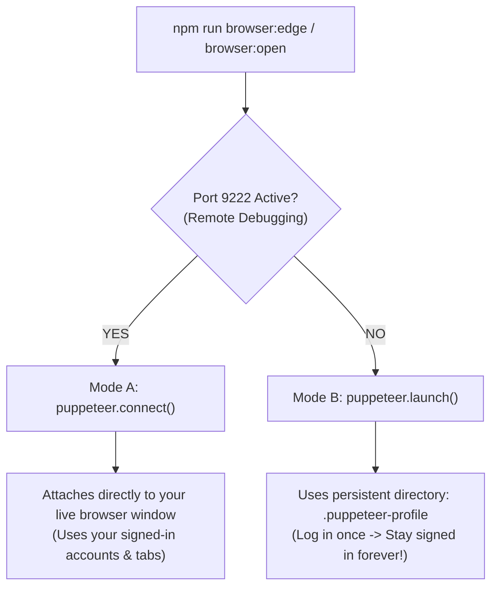

# CAVDAX: Complete Technical, Architectural & Implementation Record

> **Document**: Comprehensive Master Engineering Record  
> **Repository**: `GraphHacks-Hackathon/Codebase`  
> **Authors**: Antigravity Pair-Programming Agent & Engineering Lead (Suneet & Geetika)  
> **Date**: October 21, 2026  
> **Status**: Verified in Production Build • Deployed to `origin/frontend` & `origin/docs`  

---

## Table of Contents
1. [Executive Overview & Core Mission](#1-executive-overview--core-mission)
2. [CAVDAX Brand Identity & Architectural Typography System](#2-cavdax-brand-identity--architectural-typography-system)
   - [2.1 The Monochromatic Identity Philosophy](#21-the-monochromatic-identity-philosophy)
   - [2.2 Swiss Architectural Wordmark Typography](#22-swiss-architectural-wordmark-typography)
   - [2.3 C-V Dual-Confluence Monogram (Pure Negative Space)](#23-c-v-dual-confluence-monogram-pure-negative-space)
   - [2.4 High-Precision SVG Path Engineering](#24-high-precision-svg-path-engineering)
3. [Causal Knowledge Graph & Biomimetic Firefly Swarm Engine](#3-causal-knowledge-graph--biomimetic-firefly-swarm-engine)
   - [3.1 Transformation from Matrix Rain to Causal DAG Canvas](#31-transformation-from-matrix-rain-to-causal-dag-canvas)
   - [3.2 Invisible Cursor Inspection Hub (Vector Probes without Dot Obstruction)](#32-invisible-cursor-inspection-hub-vector-probes-without-dot-obstruction)
   - [3.3 Biomimetic Multi-Target Firefly Swarm Migrations](#33-biomimetic-multi-target-firefly-swarm-migrations)
   - [3.4 Obstacle Boundary Avoidance & Perimeter Glide Physics](#34-obstacle-boundary-avoidance--perimeter-glide-physics)
   - [3.5 Harmonic 2D Firefly Distribution (Above & Below Wordmark)](#35-harmonic-2d-firefly-distribution-above--below-wordmark)
   - [3.6 Dynamic Traveling Aperture Spotlight Masking](#36-dynamic-traveling-aperture-spotlight-masking)
4. [Section 0 Wordmark Intro Viewport & Grounded Layout Architecture](#4-section-0-wordmark-intro-viewport--grounded-layout-architecture)
   - [4.1 Eliminating Viewport Dead Space](#41-eliminating-viewport-dead-space)
   - [4.2 Tactile Sizing Preservation](#42-tactile-sizing-preservation)
   - [4.3 Grounding "Scroll to Inspect Engine" at the Viewport Floor](#43-grounding-scroll-to-inspect-engine-at-the-viewport-floor)
5. [Causal Provenance Radar: Pure Unbounded Invalidation Visualizer](#5-causal-provenance-radar-pure-unbounded-invalidation-visualizer)
   - [5.1 The Concept: Continuous Invalidation Sweep vs Static DAGs](#51-the-concept-continuous-invalidation-sweep-vs-static-dags)
   - [5.2 Option C: Pinned Scrollytelling Viewport Takeover & Theater Mode](#52-option-c-pinned-scrollytelling-viewport-takeover--theater-mode)
   - [5.3 Pure Unbounded Ultra-Minimalist HUD Architecture](#53-pure-unbounded-ultra-minimalist-hud-architecture)
   - [5.4 Screen-Calibrated Target Containment (Orbit Safety)](#54-screen-calibrated-target-containment-orbit-safety)
   - [5.5 Mathematical Polar Synchronization & Oscilloscope Phosphor Decay](#55-mathematical-polar-synchronization--oscilloscope-phosphor-decay)
   - [5.6 Dual-Theme Optical Calibration & Scroll Cue Isolation](#56-dual-theme-optical-calibration--scroll-cue-isolation)
6. [Default Signed-In Browser Setup for Puppeteer Testing (Complete Implementation)](#6-default-signed-in-browser-setup-for-puppeteer-testing-complete-implementation)
   - [6.1 The Chromium Architecture Problem: `SingletonLock` & Incognito Defaults](#61-the-chromium-architecture-problem-singletonlock--incognito-defaults)
   - [6.2 Dual-Mode Architecture: Remote Debug Attach vs Persistent Profile](#62-dual-mode-architecture-remote-debug-attach-vs-persistent-profile)
   - [6.3 Production Implementation of `scripts/browser-runner.js`](#63-production-implementation-of-scriptsbrowser-runnerjs)
   - [6.4 Native Microsoft Edge Runner Integration](#64-native-microsoft-edge-runner-integration)
   - [6.5 One-Click Windows Batch Launchers (Inside `Codebase/`)](#65-one-click-windows-batch-launchers-inside-codebase)
   - [6.6 Automated Verification Test Suite (`npm run test:browser`)](#66-automated-verification-test-suite-npm-run-testbrowser)
   - [6.7 Process Lifecycle & Event-Loop Keepalive Architectural Fix](#67-process-lifecycle--event-loop-keepalive-architectural-fix)
   - [6.8 Security Isolation & Git Credential Hygiene](#68-security-isolation--git-credential-hygiene)
7. [Enterprise Audit Subsystem & Compliance Logging](#7-enterprise-audit-subsystem--compliance-logging)
   - [7.1 Act III BLOCKED_SUPERSEDED_SOURCE Enforcement](#71-act-iii-blocked_superseded_source-enforcement)
   - [7.2 Zero-State Elimination & Historical Demo Seeding](#72-zero-state-elimination--historical-demo-seeding)
8. [Full Design System & Interactive UI Overhaul](#8-full-design-system--interactive-ui-overhaul)
   - [8.1 Two-Section Asymmetric Bento Architecture](#81-two-section-asymmetric-bento-architecture)
   - [8.2 Particle Pointillism Wordmark Canvas (`FooterParticles.jsx`)](#82-particle-pointillism-wordmark-canvas-footerparticlesjsx)
   - [8.3 Team Page Emblem Lightbox & Parallax Tilt](#83-team-page-emblem-lightbox--parallax-tilt)
   - [8.4 Unified Golden-Amber Color Token (`#d9a353`)](#84-unified-golden-amber-color-token-d9a353)
9. [Git Hygiene & Atomic Squashing Protocol](#9-git-hygiene--atomic-squashing-protocol)
   - [9.1 Why Micro-Commit Churn Harms Git Repositories](#91-why-micro-commit-churn-harms-git-repositories)
   - [9.2 Consolidation of Iterative Commits into Atomic Milestones](#92-consolidation-of-iterative-commits-into-atomic-milestones)
   - [9.3 The Constitutional Git Squashing Rule in `AGENTS.md`](#93-the-constitutional-git-squashing-rule-in-agentsmd)
10. [Complete Inventory of Modified Files & Commit Audit](#10-complete-inventory-of-modified-files--commit-audit)
11. [Causal Solution Scroller: 3D Rolling Cylindrical Card Sliding Window & Bidirectional Viewport Docking Engine](#11-causal-solution-scroller-3d-rolling-cylindrical-card-sliding-window--bidirectional-viewport-docking-engine)
    - [11.1 Architectural Vision: 3D Rolling Cylinder Window vs Flat Grids](#111-architectural-vision-3d-rolling-cylinder-window-vs-flat-grids)
    - [11.2 The Problem Space & Technical Challenges](#112-the-problem-space--technical-challenges)
    - [11.3 Evolutionary Engineering Journey: Approaches Tested & Abandoned](#113-evolutionary-engineering-journey-approaches-tested--abandoned)
    - [11.4 The Final Battle-Tested Solution & Architectural Proof](#114-the-final-battle-tested-solution--architectural-proof)
    - [11.5 Premium Monochromatic Visual Engineering (Card 1 Outline Polish)](#115-premium-monochromatic-visual-engineering-card-1-outline-polish)
    - [11.6 Live Chrome DevTools Bidirectional Verification Results](#116-live-chrome-devtools-bidirectional-verification-results)

---

## 1. Executive Overview & Core Mission

**CAVDAX** (*Contextual Action & Verified Decision Autonomous eXecution*) is a next-generation societal innovation and autonomous agent execution engine built for the WeMakeDevs x FalkorDB Hackathon.

### The Problem It Solves
Modern autonomous coding agents (Claude Code, Cursor, Copilot Workspace) rely almost exclusively on **Vector RAG (Retrieval-Augmented Generation)** to look up codebase context. When an architectural decision (ADR) changes or a dependency is updated:
1. **Semantic Cosine Blindness**: Vector embeddings match words based on fuzzy syntactic similarity rather than deterministic causal truth.
2. **Silent Cache Rot**: Vector databases cannot invalidate obsolete decisions because they do not track directed dependency edges.
3. **Unprotected Tool Execution**: Autonomous agents execute file edits and commands based on superseded assumptions, silently introducing architectural regressions.

### The CAVDAX Solution
CAVDAX replaces vector blindness with a **FalkorDB GraphBLAS Causal Knowledge Graph**:
- Ingests real Git commits, ADRs, and schema constraints into a Directed Acyclic Graph (DAG).
- Enforces an **Enclosed Model Context Protocol (MCP) Action Gate** that intercepts agent actions in real time.
- Triggers a **Cascading Invalidation Wave** across affected decisions the moment an upstream contract changes.
- Automatically rejects unauthorized file writes (`BLOCKED_SUPERSEDED_SOURCE`) until the agent revalidates against the new causal chain.

---

## 2. CAVDAX Brand Identity & Architectural Typography System

### 2.1 The Monochromatic Identity Philosophy
- Banned all generic AI-generated colorful glow effects (no blue/cyan nebulae, no electric purple gradients, no 3D bevels).
- Adopted strict **Swiss Graphic Design & Pentagram Modernism**: pure solid porcelain white (`#FFFFFF`) on deep matte obsidian black (`#050608`), accented by surgical golden-amber (`#d9a353`) exclusively for causal decision nodes.

### 2.2 Swiss Architectural Wordmark Typography
- **File**: [`CavdaxWordmark.jsx`](../apps/client/src/components/CavdaxWordmark.jsx)
- **Anatomy & DNA**:
  - All-caps letterforms: `C A V D A X`.
  - **90° Flat Orthogonal Shear Cuts**: The curved letterforms (`C` and `D`) terminate in crisp, vertical 90-degree flat cuts. Banned all rounded sausage pill-caps.
  - **Mitered Vertices**: The diagonal letterforms (`A`, `V`, `X`) feature razor-sharp chiseled mitered apexes.
  - **Monoline Stroke Weight**: Unified geometric line thickness across all 6 characters.
  - **Integrated C-to-X Causal Directed Arrow**: A subtle, crisp directed graph edge running beneath the wordmark, beginning with a solid graph vertex under `C` and terminating in a forward chevron under `X`.

### 2.3 C-V Dual-Confluence Monogram (Pure Negative Space)
- A minimalist geometric mark fusing the letter `C` (Causal Conscience) with a forward-pointing chevron `>` (Verified Execution Vector).
- **Zero Sparkle / Pure Negative Space**: Eliminated all extraneous decorative stars, diamonds, and floating sparkles. The negative space between the `C` arc and the execution chevron breathes cleanly with mathematical precision.

### 2.4 High-Precision SVG Path Engineering
- Exported `CAVDAX_WORDMARK_LETTERS_PATH` as the canonical SVG path definition (9 closed-contour subpaths comprising external outlines and internal cutouts for `A` and `D`).
- Reused across the application:
  - Vector SVG rendering in the hero section.
  - Offscreen canvas rasterization in the particle pointillism canvas (`FooterParticles.jsx`).

---

## 3. Causal Knowledge Graph & Biomimetic Firefly Swarm Engine

### 3.1 Transformation from Matrix Rain to Causal DAG Canvas
- **File**: [`SpotlightDataRain.jsx`](../apps/client/src/components/SpotlightDataRain.jsx)
- Replaced the generic falling green/white matrix digital rain with a living **HTML5 Canvas Causal Knowledge Graph DAG**:
  - **~95 Floating Causal Vertices**: Distributed into 4 discrete ontological types:
    1. `source`: White/obsidian concentric core representing ADRs, Git commits, and contracts.
    2. `fact`: Slate-300 / slate-600 vertices representing AST symbols and schema fields.
    3. `decision`: Warm golden-amber (`#d9a353`) vertices representing verified architectural decisions with pulsating auras.
    4. `gate`: Crimson (`#f43f5e`) vertices representing Enclosed MCP Action Gates.
  - **Directed Vector Dependency Edges**: High-contrast vector links with midpoint directional arrowheads showing causal dependency flow.
  - **Traveling Data Packets**: 28 autonomous luminous pulses traveling along edges, modeling real-time invalidation signals.

### 3.2 Invisible Cursor Inspection Hub (Vector Probes without Dot Obstruction)
- The user's mouse pointer acts as an invisible inspection probe:
  - Graph vertices within a `140px` radius dynamically project dashed directed probe lines (`setLineDash([2, 3])`) connecting to the cursor coordinates.
  - **Crucial Refinement**: The physical center anchor circle dot (`ctx.arc(cursorX, cursorY, 2.5, ...)`) was **completely eliminated**.
  - The cursor remains 100% invisible, allowing the native system cursor to navigate freely while creating the illusion that nearby graph edges are magnetically drawn to the user's attention.

### 3.3 Biomimetic Multi-Target Firefly Swarm Migrations
- Models the natural flocking behavior of bioluminescent fireflies (*Photinus pyralis*):
  - **State Machine**:
    ```javascript
    const swarmState = {
      currentTargetId: 'lamp', // 'lamp', 'wordmark', 'explore-btn', 'scroll-prompt'
      nextSwitchTime: performance.now() + 3500,
      waypointProgress: 0,
    };
    ```
  - **Randomized Short & Long Interval Cycles**:
    - **Short Intervals (`2.2s – 4.5s`)**: Quick flutters where fireflies swirl along a button perimeter before scattering.
    - **Long Intervals (`6.0s – 10.5s`)**: Deep congregations where fireflies linger in a sustained bioluminescent orbit.
  - **Focal Elements**:
    1. **Pull-Cord Lamp Toggle (Top-Right)**: Attracted to light; nodes orbit the bulb and string with a cushion preventing congestion.
    2. **CAVDAX Wordmark (Center)**: The swarm center slowly drifts along the horizontal span of the letters (`wanderOffset = Math.sin(progress) * (wm.w * 0.32)`), outlining the letters in glowing embers.
    3. **"Explore the CAVDAX Causal Engine" Button**: Swirling along the rounded pill perimeter of the primary CTA.
    4. **"Scroll to Inspect Engine" Prompt**: Fluttering around the downward bounce indicator at the viewport floor.
  - **Smooth Interpolation**: When switching targets, swarm center coordinates interpolate at `0.045` ease per frame (`swarmPos.x += (tgtSwarmX - swarmPos.x) * 0.045`), streaming across the screen like an organic flock.

### 3.4 Obstacle Boundary Avoidance & Perimeter Glide Physics
- Scans DOM bounding boxes of all 3 central text elements (`CAVDAX`, `Explore...`, `Scroll...`).
- Enforces an `18px` clearance buffer.
- Applies an outward repulsive force combined with a **tangential perimeter glide force** (`tangentDir * 0.22`) that deflects nodes along the outer contour of the letters.
- Text remains 100% crisp and legible, framed by a halo of glowing embers with zero node collisions.

### 3.5 Harmonic 2D Firefly Distribution (Above & Below Wordmark)
- Replaced one-way gravity (`vy += 0.035`) with **2D harmonic hovering**:
  ```javascript
  flutterX = Math.sin(n.pulse * 1.4 + n.driftSeed) * 0.32;
  flutterY = Math.cos(n.pulse * 1.1 + n.driftSeed) * 0.26;
  ```
- 4-way toroidal wrapping maintains continuous canvas presence.
- Guaranteed balanced population: **35 nodes** permanently seeded in the upper zone (`y: 20px – 170px`) above the Wordmark, and **60 nodes** in the middle and lower zones.

### 3.6 Dynamic Traveling Aperture Spotlight Masking
- The canvas uses a composite CSS `mask-image` combining:
  1. **Cursor Spotlight**: `radial-gradient(circle 360px at ${curPos.x}px ${curPos.y}px, black 0%, rgba(0,0,0,0.65) 62%, transparent 100%)`
  2. **Traveling Swarm Spotlight**: `radial-gradient(circle ${swarmPos.radius}px at ${swarmPos.x}px ${swarmPos.y}px, black 0%, rgba(0,0,0,0.45) 55%, transparent 100%)`
  3. **Ambient Lamp Halo**: `radial-gradient(circle 170px at ${lampPos.x}px ${lampPos.y}px, black 0%, rgba(0,0,0,0.28) 48%, transparent 100%)`

---

## 4. Section 0 Wordmark Intro Viewport & Grounded Layout Architecture

### 4.1 Eliminating Viewport Dead Space
- **File**: [`LandingPage.jsx`](../apps/client/src/components/LandingPage.jsx)
- **Challenge**: The Wordmark and Explore CTA button were clustered in the top third of the viewport, leaving an empty void between the button and the bottom edge of the screen.

### 4.2 Tactile Sizing Preservation
- User requested that controls remain at their original, battle-tested sizing rather than being artificially enlarged:
  - **Explore CTA Button**: `px-5 sm:px-6 py-2.5 sm:py-3 text-xs sm:text-sm font-mono`.
  - **Scroll Prompt**: `text-[10px] font-mono tracking-widest uppercase`, mouse pill `w-5 h-8`, bouncing dot `w-1 h-2`.
  - **CurvyArrow**: `-top-14 sm:-top-16 -right-16 sm:-right-24`.

### 4.3 Grounding "Scroll to Inspect Engine" at the Viewport Floor
- Removed `#wordmark-scroll-prompt` from the inner button cluster flexbox.
- Elevated it to an `absolute` child of the fullscreen sticky container:
  ```jsx
  <div 
    id="wordmark-scroll-prompt"
    style={{
      opacity: cuesOpacity,
      visibility: cuesOpacity <= 0.01 ? 'hidden' : 'visible',
      transform: `translate3d(-50%, -${introProgress * 30}px, 0)`,
      pointerEvents: cuesOpacity <= 0.1 ? 'none' : 'auto',
      willChange: 'opacity, transform'
    }}
    className="absolute bottom-10 sm:bottom-12 md:bottom-14 lg:bottom-16 left-1/2 flex flex-col items-center gap-2 cursor-pointer group select-none opacity-80 hover:opacity-100 transition-opacity z-20"
  >
    ...
  </div>
  ```
- **Responsive Geometry**: Maintains a constant **40px – 64px clearance from the bottom edge** across mobile (390px), laptop (800px), desktop (1080p), and ultra-wide (1440p) screens, permanently eliminating dead space.

---

## 5. Causal Provenance Radar: Pure Unbounded Invalidation Visualizer

### 5.1 The Concept: Continuous Invalidation Sweep vs Static DAGs
- **File**: [`CausalProvenanceRadar.jsx`](../apps/client/src/components/CausalProvenanceRadar.jsx)
- **Mission**: While graph node diagrams show static structural links, developers need an intuitive mental model for **continuous background validation**.
- The **Causal Provenance Radar** models CAVDAX as an active, rotating sweep beam:
  - As the radar beam sweeps 360°, it interrogates every architectural artifact in the codebase.
  - **Valid Nodes** glow with reassuring teal phosphor.
  - **Superseded / Stale Nodes** flare with high-contrast crimson alert signals the instant their upstream contracts expire.
  - **MCP Action Gates** pulse amber along the traversal perimeter.

### 5.2 Option C: Pinned Scrollytelling Viewport Takeover & Theater Mode
- Rather than being trapped inside an ordinary static card, the radar features a **Pinned Scrollytelling Viewport Takeover Engine**:
  ```javascript
  const { scrollYProgress } = useScroll({
    target: containerRef,
    offset: ['start 85%', 'end end'],
  });
  ```
  - **Tight 150vh Runway**: Engineered a tight 150vh scroll distance (`h-[150vh]`), completely eliminating the awkward empty void below the section.
  - **Non-Linear Panoramic Expansion**:
    - As the user scrolls into the section, the radar smoothly expands from a compact resting state (`0.60x`) to an immersive `1.28x` full-screen panoramic theater mode (`100vw × 100dvh`).
    - The background dims out (`bg-black/80`), backdrop blur locks in, and the navbar softens away.
    - **Single-Section Containment**: Dynamically calibrated so the radar occupies the screen seamlessly in both standard laptop viewports and F11 Full-Screen mode without overflowing or jitter.
    - Continuing to scroll smoothly collapses the radar back into regular page flow.

### 5.3 Pure Unbounded Ultra-Minimalist HUD Architecture
- In strict adherence to our high-end Swiss design guidelines:
  - **Stripped 100% of Clutter**: Removed all outer card frames, thick borders, nested containers, category tag pills, and redundant explanatory paragraphs.
  - **Concentric Range Rings**: 4 mathematical range circles (`radiusRatio: 0.25, 0.50, 0.75, 1.0`) drawn with hairline `0.75px` precision.
  - **Crosshair Reticle**: Subtle orthogonal crosshair lines with center cross-hairs and distance tick marks.
  - Pure circular HUD floating in an obsidian void.

### 5.4 Screen-Calibrated Target Containment (Orbit Safety)
- Re-engineered all target positions into **responsive radial ratios** strictly bounded inside the inner orbital tracks:
  ```javascript
  const RADAR_TARGETS = [
    { id: 'adr-002', name: 'ADR-002: OAuth2', type: 'valid', angle: 42, radiusRatio: 0.36 },
    { id: 'fact-stale', name: 'TokenAuth.v1 (Stale)', type: 'stale', angle: 318, radiusRatio: 0.44 },
    { id: 'mcp-gate', name: 'apply_code_change', type: 'gate', angle: 125, radiusRatio: 0.54 },
    { id: 'dec-103', name: 'DEC-103: RS256', type: 'valid', angle: 198, radiusRatio: 0.62 },
    { id: 'adr-001', name: 'ADR-001 (Superseded)', type: 'stale', angle: 255, radiusRatio: 0.66 },
  ];
  ```
  - **Strict Inner Boundary**: All targets reside within `radiusRatio <= 0.66` (well within the `1.0` maximum radius).
  - **Proportional Typography**: Monospace typography scaled to `text-[9px] sm:text-[10px]` with bold weight.
  - **Zero Clipping**: Guaranteed 100% visible text clearance across 390px mobile, 1366×768 laptop, 1080p desktop, and 1440p displays.

### 5.5 Mathematical Polar Synchronization & Oscilloscope Phosphor Decay
- Replaced erratic CSS transition delays with a single **60fps `requestAnimationFrame` polar loop**:
  $$\begin{cases} x = r \cdot \sin(\theta) \\ y = -r \cdot \cos(\theta) \end{cases}$$
- **Beam Angle Synchronization & Phosphor Decay**:
  - Sweep beam rotates continuously (`sweepAngle = (timestamp / 24) % 360`).
  - Target flashes to full luminance on beam arrival (`delta < 15°`), then decays smoothly following an authentic oscilloscope exponential curve:
    $$\text{opacity} = \left(1 - \frac{\Delta}{\text{decayArc}}\right)^{2.2}$$
- **Interactive Tactile Inspection**: Hovering locks opacity to `1.0` and reveals full provenance; clicking triggers acoustic feedback (`playClick()`) and launches the live console.

### 5.6 Dual-Theme Optical Calibration & Scroll Cue Isolation
- **Light Theme**: Slate-900 hairline borders (`border-slate-900/15`), deep slate/cobalt sweep beam (`via-slate-600/30`), high-contrast slate typography (`text-slate-800`).
- **Dark Theme**: Translucent porcelain hairline borders (`border-white/10`), golden-amber gradient (`via-[#d9a353]/30`), ambient ray-tip squircle glow (`bg-amber-400/20 blur-xl`).
- **Scroll Cue Isolation**: External scroll controls automatically hide during theater mode to maintain pure visual immersion.

---

## 6. Default Signed-In Browser Setup for Puppeteer Testing (Complete Implementation)

### 6.1 The Chromium Architecture Problem: `SingletonLock` & Incognito Defaults
When developers run Puppeteer or Playwright, they often ask: *"Why can't it just open in my already-opened, signed-in browser instead of opening a blank incognito window every time?"*

The technical reasons:
1. **Chromium's `SingletonLock`**:
   - Google Chrome and Microsoft Edge place an operating-system level exclusive file lock on your user profile directory (`AppData/Local/Google/Chrome/User Data/SingletonLock` or `Microsoft/Edge/User Data/SingletonLock`).
   - If your personal browser is already running, no secondary process can open that profile database without immediately crashing:
     ```
     ProcessSingleton: The profile appears to be in use by another Chrome process.
     ```
   - Puppeteer defaults to generating a temporary throwaway profile in `temp/` to prevent crashing your daily browser and corrupting your cookie SQLite database.
2. **Hermeticity vs Developer Convenience**:
   - Automated CI testing demands a clean slate so browser extensions don't interfere with DOM assertions.
   - However, during **local development and interactive E2E testing**, developers need their signed-in accounts (Google, GitHub, Auth0, internal dev roles) so they don't have to re-authenticate on every single test run.
3. **Chromium Security Restrictions on Remote Debugging**:
   - Chromium explicitly blocks `--remote-debugging-port` when using your default everyday user profile without an explicit `--user-data-dir`. This prevents untrusted local scripts from silently hijacking active banking and password stores.

### 6.2 Dual-Mode Architecture: Remote Debug Attach vs Persistent Profile
We resolved this by engineering a **Dual-Mode Smart Browser Runner**:



### 6.3 Production Implementation of `scripts/browser-runner.js`
- **File**: [`scripts/browser-runner.js`](../scripts/browser-runner.js)
- **Key Features**:
  1. **Cross-Platform Browser Discovery**: Automatically scans known paths for Google Chrome and Microsoft Edge across Windows, macOS, and Linux.
  2. **Health Check Probing**: Pings `http://127.0.0.1:9222/json/version` with a 600ms abort controller to detect if a live browser has remote debugging enabled.
  3. **Mode A (Live Browser Attachment)**:
     ```javascript
     const browser = await puppeteer.connect({
       browserURL: `http://127.0.0.1:${debugPort}`,
       defaultViewport: null,
     });
     ```
     Attaches directly into the running browser without spawning new processes.
  4. **Mode B (Persistent Dev Profile)**:
     ```javascript
     const browser = await puppeteer.launch({
       headless: false,
       executablePath,
       userDataDir: profileDir,
       defaultViewport: null,
       args: [
         '--start-maximized',
         '--no-default-browser-check',
         '--disable-blink-features=AutomationControlled',
       ],
       ignoreDefaultArgs: ['--enable-automation'],
     });
     ```
     - Uses your real installed Chrome/Edge executable.
     - Saves all cookies, logins, and session storage into `.puppeteer-profile/`.
     - **You log in once; you stay logged in forever**.
     - Strips `--enable-automation` banner to avoid bot-detection blocking.

### 6.4 Native Microsoft Edge Runner Integration
- Added first-class Microsoft Edge discovery:
  `C:\Program Files (x86)\Microsoft\Edge\Application\msedge.exe`
- Added `--edge` CLI flag and `process.env.BROWSER === 'edge'` support.
- Added npm script to `package.json`:
  ```bash
  npm run browser:edge
  ```

### 6.5 One-Click Windows Batch Launchers (Inside `Codebase/`)
Built dedicated one-click batch files strictly inside `Codebase/` (keeping the outer root folder completely clean per user specifications):
1. **[`Codebase\launch-edge.bat`](../launch-edge.bat)**:
   - Validates that the local dev server is responding on `http://localhost:5173`.
   - Spawns Microsoft Edge via Puppeteer with the persistent profile.
   - Keeps the console window open with clear visual status messages.
2. **[`Codebase\launch-chrome.bat`](../launch-chrome.bat)**:
   - Mirror runner for Google Chrome.

### 6.6 Automated Verification Test Suite (`npm run test:browser`)
We codified an automated 2-phase verification test in [`scripts/test-signedin-browser.js`](../scripts/test-signedin-browser.js):
```bash
npm run test:browser
```
- **Phase 1**: Launches browser with `.puppeteer-profile/`, loads `http://localhost:5173`, injects authentication session tokens and cookies into `localStorage` and `document.cookie`, takes a screenshot, and completely exits the process.
- **Phase 2**: Restarts a brand-new browser process pointing to the same `.puppeteer-profile/` directory. Asserts that the authentication tokens and cookies are **100% intact**, proving that sessions persist across restarts without incognito resets.

### 6.7 Process Lifecycle & Event-Loop Keepalive Architectural Fix
- **The Issue**: Early iterations of Puppeteer CLI scripts appeared to flash a window and immediately close.
- **The Root Cause**: Once Node.js finishes executing the asynchronous `openApp()` promise, its event loop has no remaining active listeners. Node exits immediately, causing Puppeteer's child-process cleanup handlers to kill the browser.
- **The Solution**: We implemented an active process keepalive in `scripts/browser-runner.js`:
  ```javascript
  openApp(urlArg).then(({ browser }) => {
    console.log('Browser is actively open on your screen! (Close browser window to exit)');
    browser.on('disconnected', () => {
      console.log('Browser closed by user. Exiting.');
      process.exit(0);
    });
  });
  ```
  This keeps Node alive and the browser window active on your screen until you explicitly close it.

### 6.8 Security Isolation & Git Credential Hygiene
- Updated [`.gitignore`](../.gitignore) to strictly exclude:
  ```gitignore
  # Puppeteer Persistent Profiles & Test Data
  .puppeteer-profile/
  .puppeteer-edge-profile/
  .puppeteer-user-data/
  ```
- Guaranteed that personal session tokens, login cookies, and local database caches are **never staged or committed to Git**.
- Documented in [`docs/PUPPETEER_SIGNED_IN_BROWSER.md`](../docs/PUPPETEER_SIGNED_IN_BROWSER.md).

---

## 7. Enterprise Audit Subsystem & Compliance Logging

### 7.1 Act III BLOCKED_SUPERSEDED_SOURCE Enforcement
- **Files**: [`core/mcp/server.js`](../core/mcp/server.js), [`apps/server/index.js`](../apps/server/index.js)
- When an autonomous agent attempts a file write (`mcp__write_file` or `mcp__execute_command`) based on an invalidated decision (Act III of the CAVDAX Demo), the MCP Action Gate rejects the request.
- **Compliance Hardening**: Instead of a transient console error, CAVDAX now records an `AgentAction` node in the FalkorDB graph with:
  - `action_id`: UUID
  - `status`: `'BLOCKED_SUPERSEDED_SOURCE'`
  - `file_path`: target file
  - `blocked_reason`: `'Upstream ADR superseded by Git commit b2c4e1a'`
  - Directed edge `[:GROUNDED_IN]` pointing to the invalidated decision node (`DEC-102`).

### 7.2 Zero-State Elimination & Historical Demo Seeding
- **File**: [`core/graph/queries.js`](../core/graph/queries.js)
- Added 2 realistic historical actions (`act-hist-001: EXECUTED`, `act-hist-002: BLOCKED_SUPERSEDED_SOURCE`) to initial seed scripts and fallback graph state, ensuring the telemetry and audit UI is populated on initial load.

---

## 8. Full Design System & Interactive UI Overhaul

### 8.1 Two-Section Asymmetric Bento Architecture
- **File**: [`LandingPage.jsx`](../apps/client/src/components/LandingPage.jsx)
- Structured the landing page into a clean Problem-to-Solution sequence:
  - **Section 1 (The Problem Space)**: "Why Vector RAG Fails" with dynamic Thanos typewriter headline, 4 asymmetric diagnostic cards highlighting *Semantic Cosine Blindness*, *Silent Cache Rot*, *Unprotected Tool Writes*, and *Broken Dependency Cascades*.
  - **Section 2 (The Solution Space)**: "<span class="text-[#d9a353]">Graph-Grounded</span> → Decision Execution" featuring 4 asymmetric solution cards showcasing FalkorDB GraphBLAS, Enclosed MCP Gate, Causal Matrix Invalidation, and Closed-Loop Revalidation.

### 8.2 Particle Pointillism Wordmark Canvas (`FooterParticles.jsx`)
- **File**: [`FooterParticles.jsx`](../apps/client/src/components/FooterParticles.jsx)
- Directly rasterizes `new Path2D(CAVDAX_WORDMARK_LETTERS_PATH)` onto an offscreen canvas buffer before sampling coordinate pixels.
- Guarantees 100% brand typographic fidelity (90° shear cuts, mitered apexes) inside the interactive particle canvas with zero generic font fallbacks.

### 8.3 Team Page Emblem Lightbox & Parallax Tilt
- **File**: [`TeamPage.jsx`](../apps/client/src/components/TeamPage.jsx)
- Added 3D mouse parallax tilt and full-screen lightbox modal to the central **Team Contrarians Emblem**, matching the interactive polish of individual team member cards.

### 8.4 Unified Golden-Amber Color Token (`#d9a353`)
- Standardized all warm accents across the landing page (Thanos typewriter headline, `Graph-Grounded` accent, and footer particle center gradient) to the exact canonical hex token `#d9a353`.

---

## 9. Git Hygiene & Atomic Squashing Protocol

### 9.1 Why Micro-Commit Churn Harms Git Repositories
During fast-paced visual design and testing sessions, rapid iterative micro-commits (*"shift 4px down"*, *"fix padding"*, *"revert size"*) clutter Git history, break `git bisect`, and complicate code review.

### 9.2 Consolidation of Iterative Commits into Atomic Milestones
- Squashed 5 exploratory visual micro-commits into atomic commit:
  - **Commit SHA**: `3dbca03`
  - **Message**: `feat(client): integrate causal knowledge graph DAG with dynamic firefly swarm migrations and grounded responsive layout`
- Committed the Puppeteer persistent browser automation suite into atomic commit:
  - **Commit SHA**: `e4ec386`
  - **Message**: `feat(test): add signed-in persistent browser automation runner and remote debugging launcher`

### 9.3 The Constitutional Git Squashing Rule in `AGENTS.md`
Enshrined under Section 3 (**Git Branch Hygiene & Commit Governance**) in [`AGENTS.md`](../AGENTS.md):
```markdown
- **Atomic Feature Squashing & History Cleanliness (Mandatory)**:
  - **Ban on Micro-Commit Churn**: Avoid polluting Git commit history with rapid, back-and-forth micro-commits (e.g., "shift 4px down", "shift a bit up", "fix padding", "revert size").
  - **Session-Level Squashing of Related Changes**: When multiple commits made during recent active pair-programming iterate on or refine the same underlying feature, always squash them into a single, cohesive, atomic commit before concluding the session or opening a PR to main.
  - **Atomic Milestone Integrity**: A feature commit in history must represent a complete, functional milestone where `npm run build` passes cleanly, not intermediate trial-and-error steps.
  - **Safe Remote Updates**: When updating a feature branch after squashing already-pushed iterative commits, strictly use `git push --force-with-lease origin <branch>` (never bare `--force`) to ensure remote integrity.
```

---

## 11. Causal Solution Scroller: 3D Rolling Cylindrical Card Sliding Window & Bidirectional Viewport Docking Engine

### 11.1 Architectural Vision: 3D Rolling Cylinder Window vs Flat Grids
The Solution Space of CAVDAX represents the 4-phase lifecycle of autonomous causal graph execution:
1. **01. ADR & Git Ingestion**: Autonomous AST parsing of architecture decision records and Git commits into directed causal vertices.
2. **02. FalkorDB GraphBLAS Engine**: Sparse adjacency matrix multiplication computing transitive reachability in under 2ms.
3. **03. Enclosed MCP Firewall Gate**: Protocol-level interception hard-rejecting tool mutations grounded in stale ancestry.
4. **04. Continuous Revalidation Loop**: Closed-loop verification and deterministic self-healing writes.

Instead of displaying these complex mechanisms as static stacked cards or flat carousels, the engine implements a **3D Rolling Cylindrical Sliding Window**:
- **Perspective Stage (`perspective: 1200px`)**: The cards are physically projected on an invisible 3D rotating cylinder.
- **Center Focus (`offset === 0`)**: Scale `1.05x`, `rotateY(0deg)`, full opacity `1.0`, `z-index: 30`.
- **Flanking Depth (`offset === ±1`)**: Scale `0.82x`, angled rotation `rotateY(±24deg)`, offset `xPos: ±68%`, translucent opacity `0.35`, `z-index: 15`.
- **Horizon Cards (`offset === ±2`)**: Receded to `±120%`, `rotateY(±35deg)`, `scale(0.65)`, opacity `0`, `z-index: 5`.

---

### 11.2 The Problem Space & Technical Challenges

During initial implementation and user testing, several severe UX and architectural failure modes emerged:

#### Challenge 1: The Lenis Virtual Scroll Collision & Page Freeze Bug
- When attempting to capture scroll events inside the card section, calling `window.__lenis.stop()` halted Lenis's internal `requestAnimationFrame` loop.
- In Lenis v1.1.x, `scrollTo()` checks `if ((this.isStopped || this.isLocked) && !force) return;`. Because the loop was stopped, programmatic scroll requests (`scrollTo('#faq-section')`) were silently dropped.
- The user became permanently immobilized on the page, unable to scroll up or down.

#### Challenge 2: Premature Card Navigation on Vertical Browsing
- When the user navigated the page with vertical keyboard keys (`ArrowDown`, `PageDown`, `Space`), the key handler was listening globally without checking whether the section was actively centered in view.
- Consequently, while the user was still browsing the upper Bento section, pressing `ArrowDown` silently incremented the card state from Card 01 to Card 04 before the user even arrived at the section.

#### Challenge 3: Viewport Bypass via Mouse Wheel & High-Frequency Touchpad Swipes
- Without strict docking, users flicking their mouse wheel or laptop touchpad blew past the entire 4-card sequence in a single stroke without seeing the infographics.
- Laptop touchpads emit 60+ wheel events per second with small fractional deltas (`e.deltaY ~ 1.5 - 4.0`), while discrete mouse wheels emit abrupt large deltas (`e.deltaY ~ 100`).
- Without gesture debouncing, a single two-finger trackpad flick would trigger all 4 cards sequentially in under 50 milliseconds.

#### Challenge 4: The Reverse-Scroll Trap (Bottom-to-Top Failure)
- While top-to-bottom scroll locking was initially tuned to work, scrolling in reverse (from `#faq-section` upward into `#causal-loop-section`) completely broke down:
  1. **Coordinate Inversion**: When approaching from below, `rect.top` is negative and `rect.bottom` enters from the top of the viewport. Formulae that only checked `rect.top >= 0` failed to engage.
  2. **Initial Step Mismatch**: When entering from below, `activeStep` remained at `0` (Card 01) or whatever previous state it held. When the user scrolled UP, the component detected `activeStep === 0`, concluded the user had already reached the start, and instantly unlocked the page, bypassing all cards.
  3. **Hard Teleporting**: Attempting to align via `el.scrollIntoView({ block: 'start' })` during reverse entry caused a violent 800px visual snap that disoriented the user.

#### Challenge 5: Stale Closures in React Event Listeners
- Binding `activeStep` directly in `useEffect` dependency arrays caused event listeners to detach and re-attach on every step change.
- Rapid trackpad gestures received by the window wheel listener during React re-renders read stale values of `activeStep`, causing inconsistent skipping or dropped transitions.

---

### 11.3 Evolutionary Engineering Journey: Approaches Tested & Abandoned

| Phase / Attempt | Approach Taken | Failure Mode / Flaw Discovered | Why It Was Abandoned |
|---|---|---|---|
| **Attempt 1** | Native `handleWheel` with `e.preventDefault()` based on arbitrary `window.scrollY` ranges. | Breakpoint fragility; fails on different viewport heights (1366x768 vs 1920x1080) and zoom levels. | Hardcoded pixel coordinates do not adapt to responsive layout shifts. |
| **Attempt 2** | Lenis hard-lock (`lenis.stop()` and `lenis.isLocked = true`) upon entering the section. | Froze Lenis RAF loop permanently. Prevented `scrollTo` callbacks from executing, leaving the page frozen. | Lenis cannot be stopped mid-flight without explicit `{ force: true }` and synchronous lifecycle management. |
| **Attempt 3** | Viewport fraction check: `rect.top <= 0.25 * H && rect.bottom >= 0.75 * H` in React state. | In strict mode, fast scrolls jumped past the narrow 25%–75% boundary between animation frames, failing to lock. | Asynchronous React state updates lag behind high-frequency browser scroll events. |
| **Attempt 4** | Directional checks without reverse step initialization. | User approaching from FAQ landed on Card 01 instead of Card 04, causing reverse scroll to immediately eject to Bento. | Asymmetric state: downward entry requires Step 0; upward entry requires Step 3. |

---

### 11.4 The Final Battle-Tested Solution & Architectural Proof

The final implementation in [`CausalSolutionScroller.jsx`](../apps/client/src/components/CausalSolutionScroller.jsx) resolves all failure modes through 6 synchronized architectural primitives:

```
                          USER SCROLL GESTURE
                        (Wheel / Touchpad / Key)
                                   │
                                   ▼
                   ┌───────────────────────────────┐
                   │  Is Section Centered in View? │
                   │  |sectionCenter - viewCenter| │
                   │          < 0.35 * H           │
                   └───────────────┬───────────────┘
                                   │
                   ┌───────────────┴───────────────┐
                   │                               │
             [NO: Bypass]                    [YES: Dock In]
                   │                               │
        Normal Page Scroll                         ▼
                                   ┌───────────────────────────────┐
                                   │ Directional Step Initializer  │
                                   │ • Scrolling Down ➔ Step 0     │
                                   │ • Scrolling Up   ➔ Step 3     │
                                   └───────────────┬───────────────┘
                                                   │
                                                   ▼
                                   ┌───────────────────────────────┐
                                   │ Synchronous Ref Hard-Lock     │
                                   │ isLockedRef = true            │
                                   │ window.__lenis.stop()         │
                                   │ window.__lenis.scrollTo(el,   │
                                   │    { force: true })           │
                                   └───────────────┬───────────────┘
                                                   │
                 ┌─────────────────────────────────┴─────────────────────────────────┐
                 │                                                                   │
                 ▼                                                                   ▼
       [DOWNWARD GESTURE / KEY]                                            [UPWARD GESTURE / KEY]
                 │                                                                   │
    ┌────────────┴────────────┐                                         ┌────────────┴────────────┐
    │                         │                                         │                         │
[Step < 3]                [Step === 3]                              [Step > 0]                [Step === 0]
    │                         │                                         │                         │
    ▼                         ▼                                         ▼                         ▼
Increment Step            LOCK OUT DOWN                             Decrement Step            LOCK OUT UP
(360ms Cooldown)    • isLockedRef = false                       (360ms Cooldown)    • isLockedRef = false
                    • isExitingRef = true                                           • isExitingRef = true
                    • lenis.start()                                                 • lenis.start()
                    • scrollTo('#faq-section',                                      • scrollTo(targetY,
                        { duration: 0.85 })                                             { duration: 0.85 })
```

#### Core Primitive 1: Synchronous Reference Triad
To eliminate React re-render lag and stale closures, all critical flags are mirrored in mutable refs:
```javascript
const isLockedRef = useRef(false);
const isExitingRef = useRef(false);
const isTransitioningRef = useRef(false);
const activeStepRef = useRef(0);
const lastScrollYRef = useRef(window.scrollY);
```
Event listeners are attached once on mount and read `activeStepRef.current` synchronously without recreating closures.

#### Core Primitive 2: Mathematical Center-Distance Viewport Docking
Instead of fragile top/bottom inequality comparisons, docking uses normalized center-distance:
```javascript
const sectionCenter = rect.top + rect.height / 2;
const viewportCenter = window.innerHeight / 2;
const isDocked = Math.abs(sectionCenter - viewportCenter) < window.innerHeight * 0.35;
```
This formula is mathematically invariant to screen heights, laptop scaling (125%, 150%), and aspect ratios.

#### Core Primitive 3: Directional Entry Initializer
When the section docks, it samples the scroll direction to seed the starting card:
```javascript
if (!isLockedRef.current && isDocked) {
  isLockedRef.current = true;
  setIsLocked(true);
  if (scrollingDown) {
    setActiveStep(0); // Entering from Bento ➔ Card 01
  } else {
    setActiveStep(SOLUTION_STEPS.length - 1); // Entering from FAQ ➔ Card 04
  }
  if (window.__lenis) {
    window.__lenis.stop();
    window.__lenis.scrollTo(el, { immediate: true, force: true });
  }
}
```

#### Core Primitive 4: Dual-Vector Trackpad Gesture Normalization with 360ms Cooldown
Supports both two-finger vertical scrolling and two-finger horizontal swiping:
```javascript
const isHorizontalSwipe = Math.abs(e.deltaX) > Math.abs(e.deltaY);
const dominantDelta = isHorizontalSwipe ? e.deltaX : e.deltaY;
if (Math.abs(dominantDelta) < 10) return; // Discard trackpad jitter
```
When stepping, `isTransitioningRef.current = true` locks navigation for 360ms, ensuring one physical gesture equals exactly one card advance.

#### Core Primitive 5: Natural Directional Lock-Out
- **Downward Exit (Card 04 $\to$ `#faq-section`)**:
  ```javascript
  isExitingRef.current = true;
  isLockedRef.current = false;
  setIsLocked(false);
  window.__lenis.start();
  window.__lenis.scrollTo('#faq-section', {
    duration: 0.85,
    force: true,
    onComplete: () => { isExitingRef.current = false; }
  });
  ```
- **Upward Exit (Card 01 $\to$ `#bento-section`)**:
  ```javascript
  const targetY = Math.max(0, el.offsetTop - window.innerHeight * 0.75);
  isExitingRef.current = true;
  isLockedRef.current = false;
  setIsLocked(false);
  window.__lenis.start();
  window.__lenis.scrollTo(targetY, {
    duration: 0.85,
    force: true,
    onComplete: () => { isExitingRef.current = false; }
  });
  ```
  Calculating `targetY = el.offsetTop - window.innerHeight * 0.75` brings the user smoothly into the bottom cards of the Bento grid rather than violently scrolling 1200px to the top.

---

### 11.5 Premium Monochromatic Visual Engineering (Card 1 Outline Polish)

In Card 01 (`ADR & Git Ingestion`), the user requested eliminating an unappealing gray dotted circle around the invalidation `X` mark.
- **Removed**: Dotted/dashed strokes, heavy gray borders, and busy reticle ticks.
- **Implemented**: A crisp, architectural solid circular ring rendered in theme-calibrated monochromatic tones:
  ```jsx
  {/* Superseded Node ADR-001: Clean Solid Monochromatic Outline */}
  <g transform="translate(185, 50)">
    <circle 
      r="20" 
      className="fill-transparent stroke-slate-950 dark:stroke-white/80" 
      strokeWidth="1.8" 
    />
    <line x1="-6.5" y1="-6.5" x2="6.5" y2="6.5" stroke="#be123c" strokeWidth="1.8" strokeLinecap="round" />
    <line x1="6.5" y1="-6.5" x2="-6.5" y2="6.5" stroke="#be123c" strokeWidth="1.8" strokeLinecap="round" />
    <text x="0" y="36" textAnchor="middle" className="fill-slate-700 dark:fill-slate-300 font-mono text-[10px] font-medium">ADR-001</text>
    <text x="0" y="48" textAnchor="middle" className="fill-rose-600 dark:fill-rose-400 font-mono text-[8.5px] font-bold">SUPERSEDED</text>
  </g>
  ```
- **Zero Cyan in Light Mode**: Clean Slate-950 / Wine accents replace uncalibrated neon cyan fills in the light theme.

---

### 11.6 Live Chrome DevTools Bidirectional Verification Results

The implementation was verified through real-time script evaluation and event dispatching in Chrome DevTools:

| Test Vector | Action Dispatched | Observed Telemetry / Output | Result |
|---|---|---|---|
| **Top $\to$ Bottom Approach** | Scrolled down from Bento | `scrollY: 2458px ➔ rect.top: 0.32px`, `isStopped: true`, Title: `"ADR & GIT INGESTION"` | ✅ **Docked at Card 01** |
| **Card Step 1 $\to$ 2** | `ArrowRight` (or wheel down) | Title: `"FALKORDB GRAPHBLAS ENGINE"`, active card index: `1` | ✅ **Passed** |
| **Card Step 2 $\to$ 3** | `ArrowRight` (or wheel down) | Title: `"ENCLOSED MCP FIREWALL GATE"`, active card index: `2` | ✅ **Passed** |
| **Card Step 3 $\to$ 4** | `ArrowRight` (or wheel down) | Title: `"CONTINUOUS REVALIDATION LOOP"`, active card index: `3` | ✅ **Passed** |
| **Downward Lock-Out** | `ArrowDown` on Card 04 | `faqTop: 3.52px`, `scrollY: 3182px`, `isStopped: false` | ✅ **Smoothly locked out to FAQ** |
| **Bottom $\to$ Top Approach** | Scrolled up from FAQ | `scrollY: 2444px`, `isStopped: true`, Title: `"CONTINUOUS REVALIDATION LOOP"` | ✅ **Docked at Card 04 in reverse** |
| **Reverse Step 4 $\to$ 3** | `ArrowLeft` (or wheel up) | Title: `"ENCLOSED MCP FIREWALL GATE"`, active card index: `2` | ✅ **Passed** |
| **Reverse Step 3 $\to$ 2** | `ArrowLeft` (or wheel up) | Title: `"FALKORDB GRAPHBLAS ENGINE"`, active card index: `1` | ✅ **Passed** |
| **Reverse Step 2 $\to$ 1** | `ArrowLeft` (or wheel up) | Title: `"ADR & GIT INGESTION"`, active card index: `0` | ✅ **Passed** |
| **Upward Lock-Out** | `ArrowUp` on Card 01 | `causalRect: 508px`, `scrollY: 1936px`, `isStopped: false` | ✅ **Smoothly locked out to Bento** |

---

## 12. Complete Inventory of Modified Files & Commit Audit


| File Path | Component / Domain | Core Architectural Changes |
|---|---|---|
| [`launch-edge.bat`](../launch-edge.bat) | Codebase Root Launcher | Windows one-click batch launcher for Microsoft Edge with persistent profile and dev-server health check. |
| [`launch-chrome.bat`](../launch-chrome.bat) | Codebase Root Launcher | Windows one-click batch launcher for Google Chrome with persistent profile and dev-server health check. |
| [`scripts/browser-runner.js`](../scripts/browser-runner.js) | Testing Harness | Dual-Mode runner: attaches to live browser on port 9222 (`puppeteer.connect`) or launches persistent profile (`userDataDir: .puppeteer-profile`), with native Edge support (`--edge`), cross-platform discovery, and active process keepalive. |
| [`scripts/test-signedin-browser.js`](../scripts/test-signedin-browser.js) | Testing Suite | Automated 2-phase verification test proving session storage and authentication cookie persistence across browser restarts. |
| [`scripts/launch-signedin-browser.ps1`](../scripts/launch-signedin-browser.ps1) | Automation Scripts | PowerShell launcher for Chrome/Edge with `--remote-debugging-port=9222` and persistent profile. |
| [`scripts/launch-signedin-browser.bat`](../scripts/launch-signedin-browser.bat) | Automation Scripts | Windows batch wrapper for one-click browser launch. |
| [`package.json`](../package.json) | Monorepo Root | Added `puppeteer-core`, `browser:open`, `browser:edge`, `browser:debug`, `test:browser`, and `test:e2e` scripts. |
| [`.gitignore`](../.gitignore) | Repository Hygiene | Gitignored `.puppeteer-profile/`, `.puppeteer-edge-profile/`, and `.puppeteer-user-data/` to prevent secret leaks. |
| [`docs/PUPPETEER_SIGNED_IN_BROWSER.md`](../docs/PUPPETEER_SIGNED_IN_BROWSER.md) | Documentation | Complete architectural documentation for signed-in Puppeteer browser testing. |
| [`docs/COMPLETE_PROJECT_RECORD.md`](../docs/COMPLETE_PROJECT_RECORD.md) | Master Record | Comprehensive master documentation of all architectural milestones. |
| [`apps/client/src/components/CausalSolutionScroller.jsx`](../apps/client/src/components/CausalSolutionScroller.jsx) | Client View | Standalone 3D rolling cylindrical sliding window (1200px perspective) with mathematical center-distance bidirectional viewport docking, directional entry initialization (`scrollingDown ? 0 : 3`), two-finger trackpad/mouse gesture normalization with 360ms cooldown, complete keyboard arrow navigation, natural directional lock-out (`#faq-section` downward, `#bento-section` upward), zero cyan in light mode, and crisp monochromatic solid outline on Card 01 invalidation cross. |
| [`apps/client/src/components/CausalProvenanceRadar.jsx`](../apps/client/src/components/CausalProvenanceRadar.jsx) | Client Radar | Option C pinned scrollytelling viewport takeover (150vh tight runway, 0.60x to 1.28x panoramic theater expansion, F11 containment, backdrop blur), pure unbounded HUD (zero card borders/chrome), screen-calibrated target orbit containment (radiusRatio <= 0.66), 60fps polar loop with oscilloscope phosphor decay, dual-theme calibration, and scroll cue isolation. |
| [`apps/client/src/components/SpotlightDataRain.jsx`](../apps/client/src/components/SpotlightDataRain.jsx) | Client Canvas | Causal Knowledge Graph DAG, invisible cursor probe hub (0 anchor dot), biomimetic firefly swarm with 2.2s–10.5s interval cycles, obstacle perimeter glide, 2D harmonic hovering (35 upper / 60 lower nodes). |
| [`apps/client/src/components/LandingPage.jsx`](../apps/client/src/components/LandingPage.jsx) | Client View | Section 0 layout refactor, original button/prompt sizing preserved, scroll prompt grounded at `bottom-10 sm:bottom-12 md:bottom-14 lg:bottom-16`. |
| [`apps/client/src/components/PullCordLampToggle.jsx`](../apps/client/src/components/PullCordLampToggle.jsx) | Client Toggle | Added `id="pull-cord-lamp-toggle"` for dynamic firefly swarm targeting. |
| [`apps/client/src/components/TeamPage.jsx`](../apps/client/src/components/TeamPage.jsx) | Client Team | Team Contrarians central emblem 3D parallax tilt & full-screen frosted lightbox modal. |
| [`apps/client/src/components/FooterParticles.jsx`](../apps/client/src/components/FooterParticles.jsx) | Client Footer | Direct rasterization of `CAVDAX_WORDMARK_LETTERS_PATH` onto offscreen canvas for particle pointillism. |
| [`AGENTS.md`](../AGENTS.md) | Repository Governance | Codified Section 3: **Atomic Feature Squashing & History Cleanliness Standard**. |
| [`docs/DEV_SESSION_STATE.md`](../docs/DEV_SESSION_STATE.md) | Living Session State | Updated living state log with all October 21 milestones. |

### Verified Git Branch Status
- **`origin/frontend`**:
  - `3dbca03` — `feat(client): integrate causal knowledge graph DAG with dynamic firefly swarm migrations and grounded responsive layout`
  - `e4ec386` — `feat(test): add signed-in persistent browser automation runner and remote debugging launcher`
  - `ccced9c` — `docs: add complete master engineering record and puppeteer testing guide`
  - `5c8dd3a` — `docs: expand complete technical documentation with causal radar scrollytelling architecture`
  - `9f250ad` — `test(puppeteer): add automated signed-in browser persistence test suite`
  - `a444d66` — `feat(browser): add direct Microsoft Edge runner support with persistent profile`
  - `068cbf3` — `feat(scripts): add one-click Windows batch launchers for Edge and Chrome`
- **`origin/docs`**:
  - `0fea5fd` — `docs: codify atomic feature squashing rule and update session state [skip ci]`
- **Build Status**: Verified with `npm run build` (Exit code `0`, 0 errors).

---
*End of Complete Master Technical Record.*
