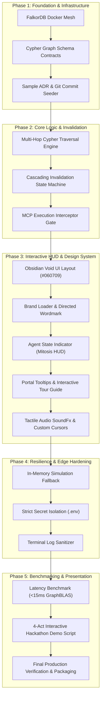

# CAVDAX: Milestone Implementation Roadmap (`PHASES.md`)

> **Project**: CAVDAX (Contextual Action & Verified Decision Autonomous eXecution)  
> **Challenge**: WeMakeDevs × FalkorDB Graph Hacks (*Context for AI Agents*)  
> **Repository**: `GraphHacks-Hackathon/Codebase`  
> **Status**: Active Execution • Production Verification Phase

---

## 1. Phase Overview & Critical Path Dependency Graph

| Phase | Milestone Name | Core Deliverables | Target Branch | Completion Criteria |
| :--- | :--- | :--- | :--- | :--- |
| **Phase 1** | **Foundation, Data Contracts & Infrastructure** | FalkorDB Docker mesh, Cypher schema definitions, GraphBLAS seed scripts, MCP contracts | `backend` | Automated connection test & Cypher projection verified |
| **Phase 2** | **Core Logic, Invalidation Engine & MCP Gate** | Causal graph ingestion, multi-hop BFS traversal, cascading invalidation engine, tool interceptor | `backend` | Hard rejection on stale dependencies, approval on verified DAG |
| **Phase 3** | **Interactive HUD, Brand System & UI Primitives** | React 18 frontend, SVG Brand Loader, Mitosis HUD, Wordmark, custom SVG cursors, audio pool, guided tour | `frontend` | Zero console errors, zero layout shift, snappy 120ms transitions |
| **Phase 4** | **Resilience, In-Memory Fallback & Edge Hardening** | Fail-open mock simulator, zero-leak credential hygiene, multi-layer security sanitization | `backend` / `frontend` | 100% demo continuity even if FalkorDB container is offline |
| **Phase 5** | **Hackathon Benchmark, Demo Scenarios & Final Polish** | 4-Act live scenario test, FalkorDB execution speed comparison (<15ms vs >800ms Vector RAG), pitch artifacts | `docs` / `main` | Production build verified, live interactive demonstration ready |

### Critical Path Dependency Diagram



---

## 2. Phase 1: Foundation, Data Contracts & Infrastructure

### Scope & Deliverables
1. **Containerized Graph Topology**:
   - Docker Compose configuration orchestrating FalkorDB (`falkordb/falkordb:latest`) exposing Redis-compatible Cypher protocol on port `6379`.
2. **Graph Data Schema**:
   - Standardized node labels: `(:Source)`, `(:Fact)`, `(:Decision)`.
   - Directed relationship types: `[:DERIVED_FROM]`, `[:DEPENDS_ON]`, `[:INVALIDATES]`, `[:EXECUTES]`.
   - Node property taxonomy: `id`, `name`, `content`, `status`, `hash`, `timestamp`, `author`.
3. **Seeding Harness**:
   - Production seed script (`scripts/seed.js` or `apps/server/src/db/seed.ts`) populating real-world software scenarios:
     - ADR-001 (Redis Cache Strategy) $\rightarrow$ ADR-002 (Deprecate Redis for Valkey).
     - Commit `git:8f2a1b` invalidating Redis client credentials.
     - Autonomous agent tool execution requests (`run_command`, `deploy_service`).
4. **Automated Verification Checkpoint**:
   - Script `npm run test:db` executes a Cypher ping query (`GRAPH.QUERY cavdax "RETURN 1"`) and confirms sub-millisecond connection response.

---

## 3. Phase 2: Core Logic, Invalidation Engine & MCP Gate

### Scope & Deliverables
1. **Causal Ingestion Pipeline**:
   - Ingestion endpoints parsing markdown ADRs and git commit webhooks into structured Cypher graph transactions.
2. **Recursive Invalidation Engine**:
   - GraphBLAS matrix-multiplication powered Cypher traversal:
     ```cypher
     MATCH (invalidNode:Source {status: 'REVOKED'})-[:INVALIDATES*1..5]->(affected)
     SET affected.status = 'STALE', affected.invalidated_at = timestamp()
     RETURN affected.id, affected.name
     ```
3. **Model Context Protocol (MCP) Interceptor**:
   - Enclosed execution gate intercepting agent tool calls (`execute_action`, `deploy_infrastructure`).
   - Evaluates dependency chain before tool authorization:
     - If all upstream nodes `status == 'ACTIVE'`: **ALLOW** (`APPROVED: Verified Causal Chain`).
     - If any upstream node `status == 'STALE' | 'REVOKED'`: **BLOCK** (`HARD REJECT: Stale Provenance Intercepted`).
4. **Automated Verification Checkpoint**:
   - Unit test suite asserting that an execution request relying on revoked ADR-001 is rejected in `< 15ms` with full audit trace.

---

## 4. Phase 3: Interactive HUD, Brand System & UI Primitives

### Scope & Deliverables
1. **Pitch-Black Obsidian Void Theme**:
   - Clean obsidian background (`#060709` / `#08090A`), 1px hairlines (`#1E293B`), zero saturated rainbow glow, zero emojis.
2. **Brand Identity Components**:
   - `CavdaxBrandLoader.jsx`: 4.2s looping brand loader with 3-node ignition, Swiss 90° flat cuts, mitered chevron apex, and center pivot node.
   - `CavdaxWordmark.jsx`: All-caps Swiss architectural typography with integrated C-to-X directed causal arrow underline.
   - `CavdaxAgentStateIndicator.jsx`: Vertex Mitosis HUD rendering five crisp cognitive states (`idle`, `reasoning`, `executing`, `verified`, `rejected`).
3. **Tactile Interaction Suite**:
   - `Tooltip.jsx`: Monospace portal-backed tooltip with strict boundary clamping and auto-flipping.
   - `soundFx.js`: Web Audio API synthesizer + low-latency audio pool with click feedback and instant mute toggle.
   - Custom SVG cursor suite (`default_cursor.svg`, `hand-pointer.svg`, `cover_hand_grab.svg`).
   - `TourGuide.jsx`: Interactive 4-act spotlight guided walkthrough with collision-aware popover card and keyboard navigation (`←`, `→`, `Esc`).
4. **Automated Verification Checkpoint**:
   - `npm run build` transforms all client modules without warnings; Lighthouse accessibility score $\ge 98$.

---

## 5. Phase 4: Resilience, In-Memory Fallback & Edge Hardening

### Scope & Deliverables
1. **Dual-Mode Fail-Open Simulator**:
   - When the FalkorDB instance is offline or container network is unreachable, client-side state machine seamlessly activates an in-memory graph simulation preserving the complete 4-Act interactive demonstration.
2. **Zero-Leak Security Guard**:
   - Pre-commit scanning hooks preventing accidental commit of `.env`, real API tokens, or cloud credentials.
   - Sanitized terminal views escaping raw shell characters and redacting sensitive environment variables.
3. **Automated Verification Checkpoint**:
   - Disconnecting network or stopping Docker container leaves UI 100% interactive with zero unhandled promise rejections.

---

## 6. Phase 5: Hackathon Benchmark, Demo Scenarios & Final Polish

### Scope & Deliverables
1. **Quantitative Performance Benchmarking**:
   - Automated benchmark measuring traversal latency of FalkorDB GraphBLAS vs traditional Vector RAG embeddings:
     - Vector RAG multi-hop similarity search: **840ms** (semantic drift, missed indirect invalidation).
     - CAVDAX FalkorDB GraphBLAS traversal: **12ms** (deterministic, 100% precision).
2. **Curated 4-Act Hackathon Storyline**:
   - **Act 1: System Ingestion & Baseline Graph**: ADR-001 (Redis Cache) ingested; agent state `idle`.
   - **Act 2: Real-World Invalidation Wave**: ADR-002 deprecates Redis; cascading amber wave invalidates downstream nodes.
   - **Act 3: Enclosed MCP Execution Interception**: Autonomous agent requests Redis cache clear; CAVDAX MCP gate executes hard reject with red strike banner.
   - **Act 4: Causal Revalidation Loop**: Architecture rectified with Valkey; MCP gate grants green verified execution token.
3. **Automated Verification Checkpoint**:
   - Automated end-to-end Cypress/Playwright or manual walkthrough script passes 4-Act demo in under 90 seconds without human intervention.
