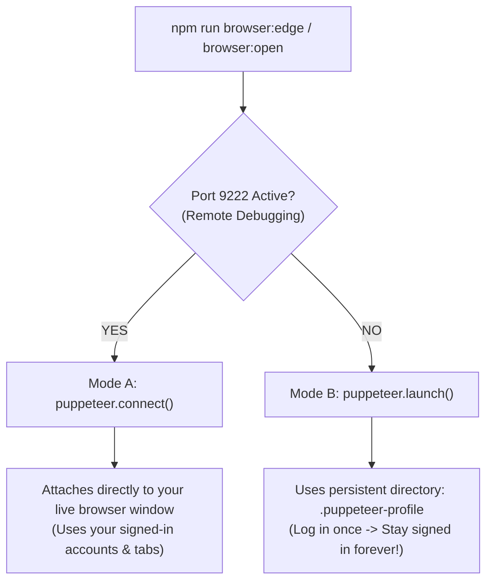

# Puppeteer Signed-In Browser Integration Guide

This guide explains how browser automation and E2E testing in **CAVDAX** connects to your **already-opened, signed-in browser accounts**, eliminating throwaway incognito windows.

---

## 1. Why Puppeteer Normally Opens in "Incognito"

When running default automation scripts (`puppeteer.launch()`), Chromium creates a clean temporary profile in your OS `temp/` folder. This happens for two reasons:

1. **Chromium's `SingletonLock`**:
   - Google Chrome and Microsoft Edge enforce a strict single-process lock on your user profile (`AppData/Local/Google/Chrome/User Data` or `AppData/Local/Microsoft/Edge/User Data`).
   - If your personal browser is already running, no other process can open or modify that profile database without crashing or throwing:
     ```
     ProcessSingleton: The profile appears to be in use by another Chrome process.
     ```
2. **Hermetic Test Isolation**:
   - Default test frameworks assume a clean slate to prevent personal browser extensions (ad blockers, dark mode switchers) from interfering with DOM queries.
3. **Chromium Remote Debugging Security Restrictions**:
   - Chromium explicitly disables `--remote-debugging-port` when using your default everyday user profile without an explicit `--user-data-dir`. This prevents untrusted scripts from silently spying on your active bank, email, and password stores.

---

## 2. Our Solution: Dual-Mode Smart Browser Runner

We implemented an intelligent dual-mode runner in [`scripts/browser-runner.js`](../scripts/browser-runner.js):



---

## 3. How to Use It

### Method 1: Persistent Profile (Recommended — Zero Setup)
Run:
```bash
# Launch Microsoft Edge
npm run browser:edge

# Or launch Google Chrome
npm run browser:open

# Or run E2E test suite
npm run test:e2e
```
- Launches Edge or Chrome using a dedicated persistent profile directory (`.puppeteer-profile/`).
- **You log into your accounts once in this window.**
- Every subsequent run keeps you **permanently signed in** with saved cookies, local storage, and session tokens!
- It never touches your personal Chrome/Edge lock, preventing crashes.

---

### Method 2: One-Click Windows Batch Launchers (Inside `Codebase/`)
For instant double-click convenience without needing a terminal:
- **Microsoft Edge**: Double-click [`Codebase\launch-edge.bat`](../launch-edge.bat)
- **Google Chrome**: Double-click [`Codebase\launch-chrome.bat`](../launch-chrome.bat)

Both batch files:
1. Verify that the CAVDAX local dev server (`http://localhost:5173`) is active.
2. Launch the browser via Puppeteer with the persistent profile.
3. Keep the browser actively open and visible on your desktop until you close it.

---

### Method 3: Attach to Your Live Daily Browser (Port 9222)
If you want Puppeteer to open a tab directly inside your active Chrome/Edge window:

1. **Launch browser with debugging enabled**:
   ```bash
   npm run browser:debug
   ```
   *(Or run `.\scripts\launch-signedin-browser.bat` / `.ps1`)*

2. **Run your Puppeteer script**:
   ```bash
   npm run browser:open
   ```
   - Puppeteer will detect the active debug port, connect instantly, and open the app without launching a new browser process!

---

## 4. Automated Verification Test Suite (`npm run test:browser`)

We built an automated 2-phase verification test in [`scripts/test-signedin-browser.js`](../scripts/test-signedin-browser.js) to prove that sessions and credentials persist across browser restarts without incognito resets:

```bash
npm run test:browser
```

### Verification Flow:
1. **Phase 1**:
   - Launches browser using `.puppeteer-profile/`.
   - Loads `http://localhost:5173`.
   - Injects simulated signed-in user credentials (`localStorage.setItem('cavdax_user_session', ...)` and `document.cookie = 'cavdax_auth_token=...'`).
   - Takes a screenshot of the authenticated view.
   - Completely closes the browser process (simulating session completion).
2. **Phase 2**:
   - Relaunches the browser in a completely fresh process with the same `.puppeteer-profile/`.
   - Asserts that the `localStorage` authentication payload and cookie token **persist 100% intact**.
   - Confirms that zero incognito wiping occurred!

---

## 5. Architectural Insight: Process Lifecycle & Event-Loop Keepalive

A common trap in Puppeteer CLI scripts is that the browser window appears to "flash and disappear" or never stay visible.

### The Root Cause
When Node.js executes an asynchronous `openApp()` function:
```javascript
// If written like this:
openApp('http://localhost:5173');
```
Once the navigation completes, Node's event loop has no remaining active timers or open listeners. Node exits immediately. When Node terminates, Puppeteer's child-process cleanup handlers send a kill signal to the browser!

### The Solution: Active Process Keepalive
In `scripts/browser-runner.js`, we implemented an explicit process keepalive listener:
```javascript
openApp(urlArg).then(({ browser }) => {
  console.log('Browser is actively open on your screen! (Close browser window to exit)');
  browser.on('disconnected', () => {
    console.log('Browser closed by user. Exiting.');
    process.exit(0);
  });
});
```
This guarantees that Node remains alive, the browser window stays open and fully interactive on your screen, and when you finally close the browser window, Node exits cleanly.

---

## 6. Programmatic Usage in Test Suites

You can import `getBrowser` or `openApp` directly into your test suites:

```javascript
import { getBrowser, openApp } from '../scripts/browser-runner.js';

// Automatically connects to live browser or persistent profile:
const { browser, page, isAttached } = await openApp('http://localhost:5173', { preferredBrowser: 'edge' });

// Perform actions with user already authenticated:
const userBadge = await page.waitForSelector('[data-testid="user-profile"]');
console.log('Logged in user:', await userBadge.evaluate(el => el.textContent));
```

---

## 7. Security & Git Hygiene

- `.puppeteer-profile/`, `.puppeteer-edge-profile/`, and `.puppeteer-user-data/` are listed in [`.gitignore`](../.gitignore).
- Personal session tokens, cookies, and local database caches are **never staged or committed to Git**.
