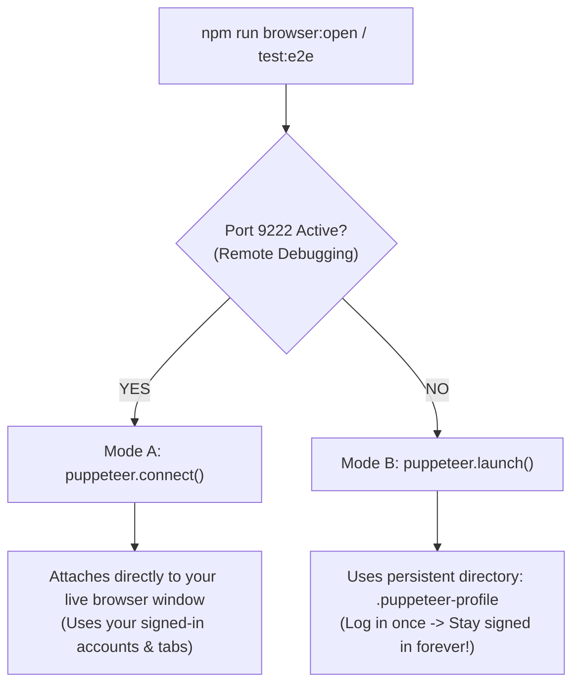

# Puppeteer Signed-In Browser Integration Guide

This guide explains how browser automation and E2E testing in **CAVDAX** connects to your **already-opened, signed-in browser accounts**, eliminating throwaway incognito windows.

---

## 1. Why Puppeteer Normally Opens in "Incognito"

When running default automation scripts (`puppeteer.launch()`), Chromium creates a clean temporary profile in your OS `temp/` folder. This happens for two reasons:

1. **Chromium's `SingletonLock`**:
   - Google Chrome and Microsoft Edge enforce a strict single-process lock on your user profile (`AppData/Local/Google/Chrome/User Data`).
   - If your personal browser is already running, no other process can open or modify that profile database without crashing or throwing:
     ```
     ProcessSingleton: The profile appears to be in use by another Chrome process.
     ```
2. **Hermetic Test Isolation**:
   - Default test frameworks assume a clean slate to prevent personal browser extensions (ad blockers, dark mode switchers) from interfering with DOM queries.

---

## 2. Our Solution: Dual-Mode Smart Browser Runner

We implemented an intelligent dual-mode runner in [`scripts/browser-runner.js`](../scripts/browser-runner.js):



---

## 3. How to Use It

### Method 1: Persistent Profile (Recommended — Zero Setup)
Run:
```bash
npm run browser:open
# or
npm run test:e2e
```
- Launches Chrome or Edge using a persistent profile directory (`.puppeteer-profile`).
- **You log into your accounts once in this window.**
- Every subsequent run keeps you **permanently signed in** with saved cookies, local storage, and session tokens!
- It never touches your personal Chrome lock, preventing crashes.

---

### Method 2: Attach to Your Live Daily Browser (Port 9222)
If you want Puppeteer to open a tab directly inside your active Chrome/Edge window:

1. **Launch browser with debugging enabled**:
   ```bash
   npm run browser:debug
   ```
   *(Or run `.\scripts\launch-signedin-browser.bat` / `.ps1`)*

2. **Run your Puppeteer script**:
   ```bash
   npm run browser:open
   ```
   - Puppeteer will detect the active debug port, connect instantly, and open the app without launching a new browser process!

---

## 4. Programmatic Usage in Test Suites

You can import `getBrowser` or `openApp` directly into your test suites:

```javascript
import { getBrowser, openApp } from '../scripts/browser-runner.js';

// Automatically connects to live browser or persistent profile:
const { browser, page, isAttached } = await openApp('http://localhost:5173');

// Perform actions with user already authenticated:
const userBadge = await page.waitForSelector('[data-testid="user-profile"]');
console.log('Logged in user:', await userBadge.evaluate(el => el.textContent));
```

---

## 5. Security & Git Hygiene

- Both `.puppeteer-profile/` and `.puppeteer-user-data/` are listed in [`.gitignore`](../.gitignore).
- Personal session tokens, cookies, and local database caches are **never staged or committed to Git**.
