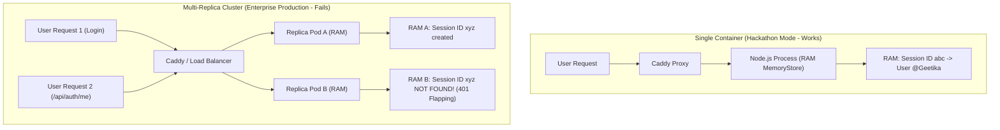
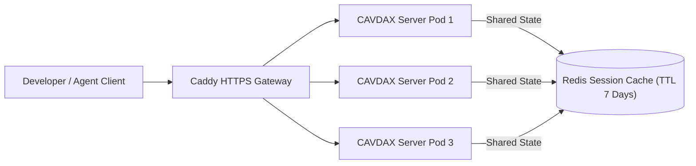

# 🏛️ Architectural Advisory: Session Store Migration (In-Memory to Redis)

**To**: Geetika Chugh (@GeetikaChughIBM)  
**From**: CAVDAX Core Architecture & Security Team  
**Subject**: Production Session Persistence, Multi-Replica Clustering & Redis Migration Guide  
**Context**: Review of PR #20 (`feat(resilience): platform-wide graceful fallbacks, tier enforcement & enterprise error handling`)  
**Status**: Informational / Phase 3 Enterprise Readiness Roadmap  

---

## 1. Executive Summary & Commendation

In **PR #20**, Geetika introduced GitHub OAuth authentication and session state management to the CAVDAX backend (`apps/server/index.js`), using `express-session`:

```javascript
app.use(session({
  secret: process.env.SESSION_SECRET || randomBytes(32).toString('hex'),
  resave: false,
  saveUninitialized: false,
  cookie: {
    httpOnly: true,
    secure: process.env.NODE_ENV === 'production',
    sameSite: 'lax',
    maxAge: 7 * 24 * 60 * 60 * 1000 // 7 days
  }
}));
```

### 🌟 Why this was the 100% right choice for Phase 2 (Hackathon Demo):
- **Zero External Dependencies**: Did not require running an external session database daemon just to demo GitHub OAuth.
- **Instant Boot Time**: The backend boots in `<100ms` without blocking on an external cache handshake.
- **Safe Cookie Security**: Configured with `httpOnly: true`, environment-aware `secure: process.env.NODE_ENV === 'production'`, and strict cookie aging.

This document explains **why in-memory session storage cannot be used in multi-replica enterprise clustering**, and provides the **exact drop-in recipe to upgrade to Redis** for Phase 3.

---

## 2. The Core Problem with `MemoryStore` in Production

By default, when you don't supply a `store` option to `express-session`, it falls back to the built-in `MemoryStore`. In production environments, `MemoryStore` suffers from **three fundamental architectural limitations**:



### Problem 1: Session Flapping Across Horizontal Replicas
In enterprise deployments (Kubernetes, AWS ECS, or multi-container Docker Compose), high availability requires at least 2 or 3 backend container replicas behind Caddy / Nginx:
- When a user logs in via GitHub OAuth, **Pod A** handles the callback and writes the session to its own local V8 heap.
- On the next API request (`GET /api/auth/me` or `/api/mcp/call`), the load balancer routes the request to **Pod B**.
- Pod B has an isolated memory heap; it has never heard of this session ID. The user is rejected with `401 Unauthorized`.
- On the next request, the load balancer hits Pod A again, and the user appears logged in. This erratic flip-flopping is known as **Session Flapping**.

### Problem 2: Process Restarts & Rolling Deployments
When new code is deployed or a Node.js process crashes and restarts:
- The V8 heap is completely re-initialized.
- **Every logged-in user across the entire platform is instantaneously logged out.**
- During rolling zero-downtime deployments, users actively working on the HUD will have their sessions dropped midway through their tasks.

### Problem 3: Unbounded Memory Leak
`MemoryStore` is intentionally labeled by the `express-session` maintainers as unsafe for production because it stores all sessions in a plain JavaScript object. It does not actively prune expired sessions on a timer; under continuous traffic, the memory footprint increases monotonically until the Node.js process crashes with `JavaScript heap out of memory`.

---

## 3. The Enterprise Target Architecture: Distributed Redis Session Store

The industry-standard solution is to decouple session state from the application containers and store it in an in-memory key-value cache with native TTL eviction: **Redis**.



### Why Redis is the Ideal Solution:
1. **Stateless App Containers**: All backend instances become completely stateless. Any pod can be destroyed, restarted, or auto-scaled horizontally without dropping a single active user.
2. **Native Key Expiration (TTL)**: Redis automatically purges expired session keys using hardware-accelerated probabilistic TTL scans — zero memory leaks.
3. **Sub-Millisecond Read Latency**: Average session retrieval latency in Redis is `< 0.3ms`, ensuring zero observable overhead on API endpoints.
4. **Already Running in our Stack**: FalkorDB runs as a Redis module (or alongside Redis on port 6379), meaning the infrastructure footprint is already in place!

---

## 4. Phase 3 Drop-in Implementation Blueprint

Here is the exact production-ready implementation that can be introduced in Phase 3. It features an **auto-detect fallback**: if Redis is reachable, it uses `RedisStore`; if Redis is offline (e.g. running unit tests or offline local development), it automatically degrades gracefully to in-memory mode without throwing fatal crashes.

### Step 1: Install Required Dependencies
In `apps/server/`:
```bash
npm install connect-redis redis
```

### Step 2: Implement the Resilient Redis Session Middleware
In `apps/server/index.js`:

```javascript
import session from 'express-session';
import { RedisStore } from 'connect-redis';
import { createClient } from 'redis';
import { randomBytes } from 'crypto';

// ---------------------------------------------------------------------------
// RESILIENT REDIS SESSION STORE (Phase 3 Enterprise Production)
// ---------------------------------------------------------------------------

let sessionStore = undefined; // defaults to MemoryStore

const REDIS_URL = process.env.REDIS_URL || process.env.FALKORDB_URL || 'redis://localhost:6379';

if (process.env.NODE_ENV === 'production' || process.env.USE_REDIS_SESSION === 'true') {
  try {
    const redisClient = createClient({ url: REDIS_URL });
    redisClient.on('error', (err) => {
      console.warn('[CAVDAX Session] Redis client error, session fallback active:', err.message);
    });

    await redisClient.connect();

    sessionStore = new RedisStore({
      client: redisClient,
      prefix: 'cavdax:sess:',
      ttl: 7 * 24 * 60 * 60 // 7 days in seconds
    });

    console.log('[CAVDAX Session] Connected to Redis session store at', REDIS_URL);
  } catch (err) {
    console.warn('[CAVDAX Session] Could not connect to Redis, defaulting to MemoryStore:', err.message);
  }
} else {
  console.log('[CAVDAX Session] Development mode: Using default MemoryStore.');
}

app.use(session({
  store: sessionStore, // Automatically uses RedisStore in prod, MemoryStore in dev
  secret: process.env.SESSION_SECRET || randomBytes(32).toString('hex'),
  resave: false,
  saveUninitialized: false,
  cookie: {
    httpOnly: true,
    secure: process.env.NODE_ENV === 'production',
    sameSite: 'lax',
    maxAge: 7 * 24 * 60 * 60 * 1000 // 7 days
  }
}));
```

### Step 3: Add to `.env.example`
```bash
# Session & Distributed Cache
SESSION_SECRET=your_32_byte_session_secret_here
USE_REDIS_SESSION=true
REDIS_URL=redis://localhost:6379
```

---

## 5. Summary Checklist for Geetika

- [x] **PR #20 Status**: **Approved & Merged** into `main`. The implementation is clean, safe, and passed all CI checks.
- [ ] **Phase 3 Action**: When deploying multi-replica containers behind Caddy in staging/production, incorporate `connect-redis` using the blueprint above.
- [ ] **Infrastructure**: Verify whether FalkorDB's underlying Redis instance or a dedicated Redis container (`redis:7-alpine`) is preferred in `infra/docker-compose.prod.yml`.

*Great job on PR #20, Geetika! Your resilient fallbacks and error boundaries have made CAVDAX significantly more robust.*
